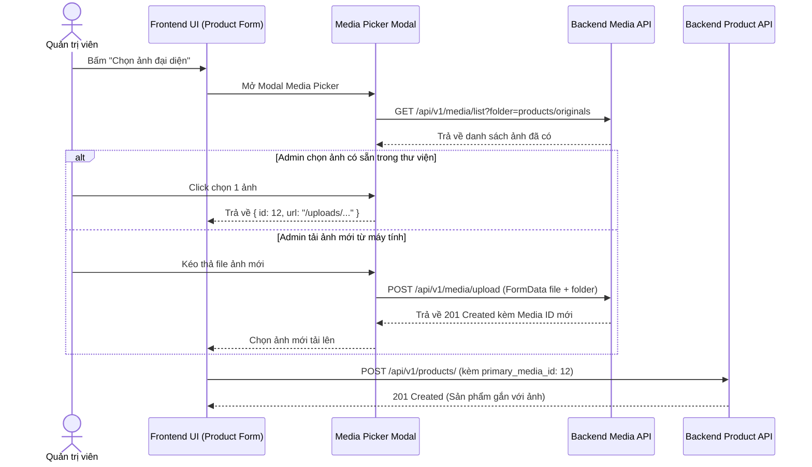

# 📁 ĐẶC TẢ KỸ THUẬT MODULE QUẢN LÝ MEDIA TẬP TRUNG (DÀNH CHO FRONTEND)
> **Dự án:** H'Mông Fashion (H'Mông May)  
> **Backend Framework:** FastAPI, Python Multipart, SQLAlchemy 2.0  
> **Tài liệu tham khảo cho:** Frontend Developers (Next.js / React / Vue)  
> **Phiên bản tài liệu:** v1.0.0  
> **Mục tiêu:** Cung cấp đầy đủ ngữ cảnh nghiệp vụ, lược đồ dữ liệu, API contracts, TypeScript interfaces và code mẫu để FE xây dựng thư viện Media tập trung và Modal chọn file.

---

## 📑 MỤC LỤC
1. [Tổng quan Module Media](#1-tổng-quan-module-media)
2. [Cấu hình & Môi trường Kết nối](#2-cấu-hình--môi-trường-kết-nối)
3. [Phân cấp Thư mục & Ma trận Phân quyền (RBAC Matrix)](#3-phân-cấp-thư-mục--ma-trận-phân-quyền-rbac-matrix)
4. [Đặc tả Chi tiết API Endpoints](#4-đặc-tả-chi-tiết-api-endpoints)
   - [4.1. Upload Tệp Media (POST /media/upload)](#41-upload-tệp-media)
   - [4.2. Lấy Danh sách Tệp Media (GET /media/list)](#42-lấy-danh-sách-tệp-media-có-bộ-lọc--phân-trang)
   - [4.3. Xem Chi tiết Tệp Media (GET /media/{id})](#43-lấy-chi-tiết-1-tệp-media)
   - [4.4. Cập nhật Mô tả Tệp - Alt text (PUT /media/{id})](#44-cập-nhật-thông-tin-tệp-alt-text)
   - [4.5. Xóa Tệp Media (DELETE /media/{id})](#45-xóa-tệp-media)
   - [4.6. Chuẩn Phản hồi Lỗi & Bảng Mã Lỗi Nghiệp Vụ](#46-cấu-trúc-phản-hồi-lỗi-chuẩn-hóa-toàn-hệ-thống)
5. [TypeScript Types & Interfaces](#5-typescript-interfaces--enums)
6. [Luồng Nghiệp vụ & Sơ đồ Tương tác UI/UX](#6-hướng-dẫn-tích-hợp-theo-các-luồng-nghiệp-vụ-use-cases)
7. [Code Mẫu Triển khai Phía Frontend](#7-code-mẫu-triển-khai-phía-frontend)
   - [7.1. API Service (Axios có Upload Progress)](#71-file-service-srcservicesmediaservicets)
   - [7.2. Helper Tiện ích (Format Bytes & URL)](#72-file-tiện-ích-định-dạng-srcutilsmediautilsts)
   - [7.3. Component React Kéo Thả Upload Dropzone](#73-component-react-mẫu-kéo-thả-upload-có-progress-bar-mediadropzonetsx)
8. [Checklist Hoàn thiện UI/UX cho Frontend Dev](#8-checklist-hoàn-thiện-uiux-cho-frontend-dev)

---

## 1. Tổng quan Module Media

Module Media Management là phân hệ **quản trị và lưu trữ tệp tin tập trung** (hình ảnh, video) của toàn hệ thống H'Mông Fashion:
- **Lưu trữ chuẩn hóa:** Tệp tin tải lên được phân loại tự động theo cây thư mục (`folder`) nghiệp vụ.
- **Bảo mật tên tệp:** Backend tự sinh chuỗi UUID ngẫu nhiên cho tên file trên ổ đĩa để tránh ghi đè và chống path traversal.
- **Tích hợp liên module:** Các module khác (Sản phẩm, Đơn may đo, Hồ sơ cá nhân, Banner) liên kết với Media qua `media_id` hoặc URL tương đối `/uploads/...`.
- **Thư viện Media tái sử dụng:** Frontend có thể xây dựng **Thư viện File (Media Library)** độc lập hoặc **Media Picker Dialog (Modal chọn ảnh)** nhúng vào các Form tạo sản phẩm, đổi avatar.

---

## 2. Cấu hình & Môi trường Kết nối

| Thành phần | Đường dẫn (Development) | Ghi chú |
| :--- | :--- | :--- |
| **Backend Base URL** | `http://127.0.0.1:8000` | Cấu hình biến môi trường `NEXT_PUBLIC_API_URL` |
| **API Prefix** | `/api/v1` | Tất cả endpoint bắt đầu bằng `/api/v1` |
| **Media Base Endpoint** | `http://127.0.0.1:8000/api/v1/media` | Endpoint quản lý media |
| **Thư mục ảnh tĩnh** | `http://127.0.0.1:8000/uploads/...` | Backend mount trực tiếp thư mục `uploads/` |

> [!IMPORTANT]
> Giá trị trường `url` trả về từ Backend là **đường dẫn tương đối** (ví dụ: `/uploads/products/originals/8a4f9b...webp`).
> Frontend cần ghép với Base URL để hiển thị:
> ```ts
> export const getFullMediaUrl = (relativeUrl?: string | null): string => {
>   if (!relativeUrl) return '/placeholder.png';
>   if (relativeUrl.startsWith('http://') || relativeUrl.startsWith('https://')) return relativeUrl;
>   const baseUrl = process.env.NEXT_PUBLIC_API_URL || 'http://127.0.0.1:8000';
>   return `${baseUrl.replace(/\/$/, '')}${relativeUrl}`;
> };
> ```

---

## 3. Phân cấp Thư mục & Ma trận Phân quyền (RBAC Matrix)

### 3.1. Danh mục Thư mục Phân cấp (`MediaFolder`)
| Giá trị enum `folder` | Tên hiển thị UI | Loại tệp | Mô tả nghiệp vụ |
| :--- | :--- | :---: | :--- |
| `products/originals` | Ảnh gốc sản phẩm | IMAGE | Ảnh chất lượng cao dùng cho trang chi tiết |
| `products/thumbnails` | Ảnh thu nhỏ sản phẩm | IMAGE | Ảnh vuông tỷ lệ 1:1 dùng cho danh sách / thẻ card |
| `products/zooms` | Ảnh chi tiết / phóng to | IMAGE | Ảnh zoom siêu nét chụp hoa văn vải thổ cẩm |
| `tailors` | Ảnh mẫu may đo | IMAGE | Khách hàng tải ảnh mẫu yêu cầu may hoặc nhân viên tải lên |
| `banners` | Banner quảng cáo | IMAGE | Ảnh slider trang chủ, banner chiến dịch khuyến mãi |
| `avatars` | Ảnh đại diện | IMAGE | Ảnh profile người dùng |
| `videos/products` | Video sản phẩm | VIDEO | Video ngắn review trang phục, video cận cảnh chất vải |

### 3.2. Giới hạn Định dạng & Dung lượng Tệp
- **Hình ảnh (`IMAGE`):** Định dạng `.jpg`, `.jpeg`, `.png`, `.webp`, `.gif`, `.svg` - Dung lượng tối đa: **15 MB**.
- **Video (`VIDEO`):** Định dạng `.mp4`, `.mov`, `.webm`, `.mkv` - Dung lượng tối đa: **100 MB**.

### 3.3. Ma trận Phân quyền (RBAC Matrix)
| Hành động | `tailors` | `avatars` | `products/*`, `banners`, `videos/*` |
| :--- | :---: | :---: | :---: |
| **Upload tệp** (`POST /media/upload`) | Public (Khách vãng lai & User) | User đăng nhập (Bearer Token) | **Yêu cầu ROLE_ADMIN hoặc ROLE_STAFF** |
| **Xem danh sách** (`GET /media/list`) | Public | Public | Public |
| **Xem chi tiết** (`GET /media/{id}`) | Public | Public | Public |
| **Sửa thông tin** (`PUT /media/{id}`) | ROLE_ADMIN / ROLE_STAFF | ROLE_ADMIN / ROLE_STAFF | ROLE_ADMIN / ROLE_STAFF |
| **Xóa tệp** (`DELETE /media/{id}`) | ROLE_ADMIN / ROLE_STAFF | ROLE_ADMIN / ROLE_STAFF | ROLE_ADMIN / ROLE_STAFF |

---

## 4. Đặc tả Chi tiết API Endpoints

### 4.1. Upload Tệp Media
- **Method:** `POST`
- **URL:** `/api/v1/media/upload`
- **Content-Type:** `multipart/form-data`
- **Headers:** `Authorization: Bearer <access_token>` *(Bắt buộc nếu folder là avatars, products, banners, videos)*

#### Request Body (FormData):
| Trường | Kiểu dữ liệu | Bắt buộc | Mặc định | Mô tả |
| :--- | :--- | :---: | :--- | :--- |
| `file` | `Binary / File` | **Có** | - | File hình ảnh hoặc video được chọn từ máy |
| `folder` | `String` | Không | `products/originals` | Một trong các giá trị enum thư mục ở mục 3.1 |
| `alt_text` | `String` | Không | `null` | Chú thích mô tả ảnh (hỗ trợ SEO & Accessibility) |

#### Response Thành công (`201 Created`):
```json
{
  "id": 12,
  "filename": "vay-hmong-hoa-hoa-tiet.jpg",
  "url": "/uploads/products/originals/e7529432d4314cb6a386129a650c8e31.jpg",
  "folder": "products/originals",
  "media_type": "IMAGE",
  "file_type": "image/jpeg",
  "file_size": 2451000,
  "alt_text": "Váy H'Mông Hoa thêu tay truyền thống",
  "created_at": "2026-11-13T03:30:00.000000Z"
}
```

---

### 4.2. Lấy Danh sách Tệp Media (Có Bộ lọc & Phân trang)
- **Method:** `GET`
- **URL:** `/api/v1/media/list`
- **Headers:** Không yêu cầu token (Public)

#### Query Parameters:
| Tham số | Kiểu dữ liệu | Mặc định | Mô tả |
| :--- | :--- | :--- | :--- |
| `folder` | `string` | `null` | Lọc theo thư mục (ví dụ: `products/originals`, `banners`,...) |
| `media_type` | `string` | `null` | Lọc theo loại tệp: `IMAGE` hoặc `VIDEO` |
| `skip` | `integer` | `0` | Vị trí offset phân trang |
| `limit` | `integer` | `50` | Số lượng bản ghi mỗi trang (Tối đa: 100) |

#### Response Thành công (`200 OK`):
```json
[
  {
    "id": 12,
    "filename": "vay-hmong-hoa-hoa-tiet.jpg",
    "url": "/uploads/products/originals/e7529432d4314cb6a386129a650c8e31.jpg",
    "folder": "products/originals",
    "media_type": "IMAGE",
    "file_type": "image/jpeg",
    "file_size": 2451000,
    "alt_text": "Váy H'Mông Hoa thêu tay truyền thống",
    "created_at": "2026-11-13T03:30:00.000000Z"
  }
]
```

---

### 4.3. Lấy Chi tiết 1 Tệp Media
- **Method:** `GET`
- **URL:** `/api/v1/media/{media_id}`
- **Headers:** Không yêu cầu token
- **Response Thành công (`200 OK`):** Trả về đối tượng `MediaResponse`.
- **Response Thất bại (`404 Not Found`):** Không tìm thấy media với ID chỉ định.

---

### 4.4. Cập nhật Thông tin Tệp (Alt text)
- **Method:** `PUT`
- **URL:** `/api/v1/media/{media_id}`
- **Headers:** `Authorization: Bearer <access_token>` *(Admin/Staff)*
- **Content-Type:** `application/json`

#### Request Body:
```json
{
  "alt_text": "Váy truyền thống H'Mông Đen hoa văn tay áo"
}
```

#### Response Thành công (`200 OK`):
Trả về đối tượng `MediaResponse` sau khi cập nhật.

---

### 4.5. Xóa Tệp Media
- **Method:** `DELETE`
- **URL:** `/api/v1/media/{media_id}`
- **Headers:** `Authorization: Bearer <access_token>` *(Admin/Staff)*
- **Hành vi phía Server:** Xóa bản ghi trong Database đồng thời xóa file vật lý tương ứng trên ổ đĩa.
- **Response Thành công:** `204 No Content` (Không có body).

---

### 4.6. Cấu trúc Phản hồi Lỗi Chuẩn Hóa Toàn Hệ Thống
```json
{
  "success": false,
  "status_code": 400,
  "error_code": "IMAGE_SIZE_EXCEEDED",
  "message": "Dung lượng ảnh vượt quá giới hạn cho phép (15MB).",
  "detail": "Dung lượng ảnh vượt quá giới hạn cho phép (15MB).",
  "details": null,
  "timestamp": "2026-11-13T03:32:00.000000Z",
  "path": "/api/v1/media/upload"
}
```

#### Các mã `error_code` đặc thù:
| `error_code` | `status_code` | Nguyên nhân & Hành động xử lý trên FE |
| :--- | :---: | :--- |
| `IMAGE_SIZE_EXCEEDED` | 400 | Dung lượng ảnh > 15MB. Hiển thị Toast cảnh báo người dùng. |
| `VIDEO_SIZE_EXCEEDED` | 400 | Dung lượng video > 100MB. Cảnh báo người dùng. |
| `UNSUPPORTED_MEDIA_TYPE`| 400 | Đuôi file không thuộc danh sách cho phép. |
| `UNAUTHORIZED` | 401 | Chưa đăng nhập hoặc token hết hạn (Gọi Refresh Token hoặc Redirect Login). |
| `INSUFFICIENT_ROLE` | 403 | Tài khoản không có quyền tải lên thư mục quản trị này. |
| `MEDIA_NOT_FOUND` | 404 | Không tồn tại file với ID chỉ định. |

---

## 5. TypeScript Interfaces & Enums

Tạo file `src/types/media.ts`:

```typescript
// Định nghĩa enum các thư mục lưu trữ
export enum MediaFolder {
  PRODUCTS_ORIGINALS = 'products/originals',
  PRODUCTS_THUMBNAILS = 'products/thumbnails',
  PRODUCTS_ZOOMS = 'products/zooms',
  TAILORS = 'tailors',
  BANNERS = 'banners',
  AVATARS = 'avatars',
  VIDEOS_PRODUCTS = 'videos/products',
}

// Định nghĩa enum loại media
export enum MediaType {
  IMAGE = 'IMAGE',
  VIDEO = 'VIDEO',
}

// Đối tượng Media trả về từ Backend
export interface MediaFile {
  id: number;
  filename: string;
  url: string;
  folder: MediaFolder | string;
  media_type: MediaType | string;
  file_type: string;
  file_size: number;
  alt_text?: string | null;
  created_at: string;
}

// Request payload cập nhật
export interface MediaUpdateRequest {
  alt_text?: string;
}

// Query parameters khi lấy danh sách
export interface MediaListParams {
  folder?: MediaFolder | string;
  media_type?: MediaType | string;
  skip?: number;
  limit?: number;
}
```

---

## 6. Hướng dẫn Tích hợp theo Các Luồng Nghiệp vụ (Use Cases)

### Luồng 1: Modal Chọn File Media (Media Picker Dialog) trong Form Tạo Sản phẩm


---

## 7. Code Mẫu Triển khai Phía Frontend

### 7.1. File Service: `src/services/mediaService.ts`
```typescript
import axios, { AxiosProgressEvent } from 'axios';
import { MediaFile, MediaFolder, MediaListParams, MediaUpdateRequest } from '@/types/media';

const API_BASE_URL = process.env.NEXT_PUBLIC_API_URL || 'http://127.0.0.1:8000';

const apiClient = axios.create({
  baseURL: `${API_BASE_URL}/api/v1`,
});

apiClient.interceptors.request.use((config) => {
  const token = typeof window !== 'undefined' ? localStorage.getItem('access_token') : null;
  if (token) {
    config.headers.Authorization = `Bearer ${token}`;
  }
  return config;
});

export const mediaService = {
  /**
   * Upload tệp tin lên hệ thống
   */
  async upload(
    file: File,
    folder: MediaFolder = MediaFolder.PRODUCTS_ORIGINALS,
    altText?: string,
    onProgress?: (percent: number) => void
  ): Promise<MediaFile> {
    const formData = new FormData();
    formData.append('file', file);
    formData.append('folder', folder);
    if (altText) {
      formData.append('alt_text', altText);
    }

    const response = await apiClient.post<MediaFile>('/media/upload', formData, {
      headers: {
        'Content-Type': 'multipart/form-data',
      },
      onUploadProgress: (progressEvent: AxiosProgressEvent) => {
        if (progressEvent.total && onProgress) {
          const percent = Math.round((progressEvent.loaded * 100) / progressEvent.total);
          onProgress(percent);
        }
      },
    });

    return response.data;
  },

  /**
   * Lấy danh sách media có phân trang và lọc
   */
  async getList(params?: MediaListParams): Promise<MediaFile[]> {
    const response = await apiClient.get<MediaFile[]>('/media/list', { params });
    return response.data;
  },

  /**
   * Xem chi tiết 1 tệp tin
   */
  async getById(mediaId: number): Promise<MediaFile> {
    const response = await apiClient.get<MediaFile>(`/media/${mediaId}`);
    return response.data;
  },

  /**
   * Cập nhật alt_text
   */
  async update(mediaId: number, data: MediaUpdateRequest): Promise<MediaFile> {
    const response = await apiClient.put<MediaFile>(`/media/${mediaId}`, data);
    return response.data;
  },

  /**
   * Xóa tệp vĩnh viễn khỏi server
   */
  async delete(mediaId: number): Promise<void> {
    await apiClient.delete(`/media/${mediaId}`);
  },
};
```

### 7.2. File Tiện ích Định dạng: `src/utils/mediaUtils.ts`
```typescript
/**
 * Chuyển đổi dung lượng byte sang định dạng đọc được (KB, MB)
 */
export const formatBytes = (bytes: number, decimals = 2): string => {
  if (bytes === 0) return '0 Bytes';
  const k = 1024;
  const dm = decimals < 0 ? 0 : decimals;
  const sizes = ['Bytes', 'KB', 'MB', 'GB'];
  const i = Math.floor(Math.log(bytes) / Math.log(k));
  return `${parseFloat((bytes / Math.pow(k, i)).toFixed(dm))} ${sizes[i]}`;
};

/**
 * Ghép URL ảnh tĩnh với domain Backend
 */
export const getFullMediaUrl = (relativeUrl?: string | null): string => {
  if (!relativeUrl) return '/placeholder-image.png';
  if (relativeUrl.startsWith('http://') || relativeUrl.startsWith('https://')) {
    return relativeUrl;
  }
  const baseUrl = process.env.NEXT_PUBLIC_API_URL || 'http://127.0.0.1:8000';
  return `${baseUrl.replace(/\/$/, '')}${relativeUrl}`;
};
```

### 7.3. Component React Mẫu: Kéo thả Upload có Progress Bar (`MediaDropzone.tsx`)
```tsx
import React, { useState } from 'react';
import { mediaService } from '@/services/mediaService';
import { MediaFile, MediaFolder } from '@/types/media';

interface Props {
  folder?: MediaFolder;
  onUploadSuccess: (media: MediaFile) => void;
}

export const MediaDropzone: React.FC<Props> = ({
  folder = MediaFolder.PRODUCTS_ORIGINALS,
  onUploadSuccess,
}) => {
  const [uploading, setUploading] = useState(false);
  const [progress, setProgress] = useState(0);
  const [errorMessage, setErrorMessage] = useState<string | null>(null);

  const handleFileChange = async (e: React.ChangeEvent<HTMLInputElement>) => {
    const files = e.target.files;
    if (!files || files.length === 0) return;

    const file = files[0];
    setErrorMessage(null);

    const MAX_SIZE_MB = 15;
    if (file.size > MAX_SIZE_MB * 1024 * 1024) {
      setErrorMessage(`File quá lớn. Vui lòng chọn tệp nhỏ hơn ${MAX_SIZE_MB}MB.`);
      return;
    }

    try {
      setUploading(true);
      setProgress(0);
      const media = await mediaService.upload(file, folder, file.name, (pct) => {
        setProgress(pct);
      });
      onUploadSuccess(media);
    } catch (err: any) {
      const serverMessage = err.response?.data?.message || 'Có lỗi xảy ra khi tải lên tệp.';
      setErrorMessage(serverMessage);
    } finally {
      setUploading(false);
    }
  };

  return (
    <div className="border-2 border-dashed border-gray-300 rounded-lg p-6 text-center hover:border-blue-500 transition-colors">
      <input
        type="file"
        id="file-upload"
        className="hidden"
        onChange={handleFileChange}
        accept="image/*,video/*"
        disabled={uploading}
      />
      <label htmlFor="file-upload" className="cursor-pointer">
        <div className="flex flex-col items-center">
          <svg className="w-12 h-12 text-gray-400 mb-2" fill="none" stroke="currentColor" viewBox="0 0 24 24">
            <path strokeLinecap="round" strokeLinejoin="round" strokeWidth="2" d="M7 16a4 4 0 01-.88-7.903A5 5 0 1115.9 6L16 6a5 5 0 011 9.9M15 13l-3-3m0 0l-3 3m3-3v12" />
          </svg>
          <span className="text-sm font-medium text-gray-600">
            {uploading ? `Đang tải lên... ${progress}%` : 'Nhấn để chọn ảnh hoặc kéo thả vào đây'}
          </span>
          <span className="text-xs text-gray-400 mt-1">Hỗ trợ JPG, PNG, WEBP tối đa 15MB</span>
        </div>
      </label>

      {uploading && (
        <div className="w-full bg-gray-200 rounded-full h-2.5 mt-4 overflow-hidden">
          <div
            className="bg-blue-600 h-2.5 rounded-full transition-all duration-200"
            style={{ width: `${progress}%` }}
          />
        </div>
      )}

      {errorMessage && (
        <p className="text-sm text-red-500 mt-2 font-medium">{errorMessage}</p>
      )}
    </div>
  );
};
```

---

## 8. Checklist Hoàn thiện UI/UX cho Frontend Dev

- [ ] **Tab chuyển thư mục:** Tạo thanh Tab gồm `Tất cả`, `Ảnh sản phẩm`, `Ảnh mẫu may đo`, `Banner`, `Ảnh đại diện`, `Video` tương ứng với các giá trị `folder`.
- [ ] **Chế độ xem Grid / List:** Hỗ trợ xem dạng lưới thumbnail kèm kích thước tệp, loại định dạng và ngày tải lên.
- [ ] **Nút Copy link nhanh:** Cho phép copy đường dẫn tĩnh tuyệt đối `http://.../uploads/...` vào Clipboard chỉ bằng 1 cú click.
- [ ] **Cảnh báo trước khi Xóa:** Thêm Modal xác nhận "Bạn có chắc chắn muốn xóa vĩnh viễn tệp này khỏi máy chủ? Thao tác này không thể hoàn tác!".
- [ ] **Kiểm tra trạng thái xác thực:** Ẩn hoặc vô hiệu hóa các nút Upload vào các folder quản trị (`products/*`, `banners`) nếu user không có role `ROLE_ADMIN` hoặc `ROLE_STAFF`.
- [ ] **Xử lý Skeleton / Lazy loading:** Hình ảnh trong thư viện cần được render kèm thẻ `loading="lazy"` hoặc Next.js `<Image unoptimized />` để tránh nghẽn băng thông khi danh sách media lớn.
