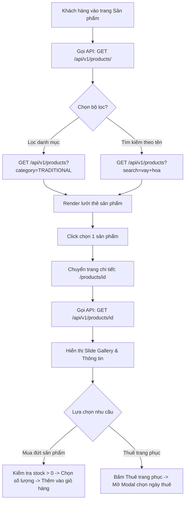
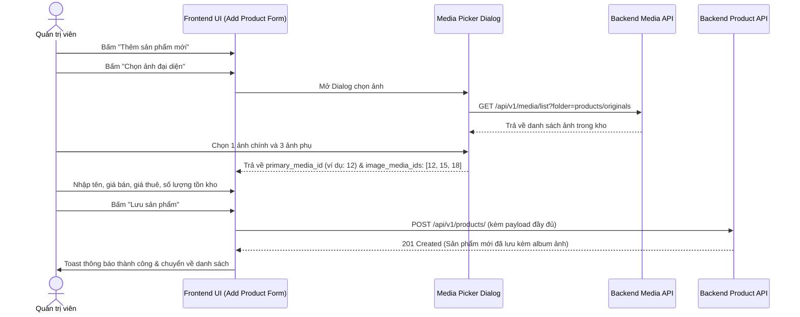

# 👗 ĐẶC TẢ KỸ THUẬT MODULE SẢN PHẨM & PHỤ KIỆN (DÀNH CHO FRONTEND)
> **Dự án:** H'Mông Fashion (H'Mông May)  
> **Backend Framework:** FastAPI, SQLAlchemy 2.0, Pydantic v2  
> **Tài liệu tham khảo cho:** Frontend Developers (Next.js / React / Vue)  
> **Phiên bản tài liệu:** v1.0.0  
> **Mục tiêu:** Cung cấp đầy đủ ngữ cảnh nghiệp vụ, lược đồ dữ liệu, API contracts, TypeScript interfaces và code mẫu để FE xây dựng module Sản phẩm hoàn chỉnh.

---

## 📑 MỤC LỤC
1. [Tổng quan Nghiệp vụ](#1-tổng-quan-nghiệp-vụ)
2. [Cấu hình & Môi trường Kết nối](#2-cấu-hình--môi-trường-kết-nối)
3. [Lược đồ Dữ liệu & Thuộc tính (Data Models)](#3-lược-đồ-dữ-liệu--thuộc-tính-data-models)
4. [Đặc tả Chi tiết API Endpoints](#4-đặc-tả-chi-tiết-api-endpoints)
   - [4.1. Lấy Danh sách Sản phẩm (Public)](#41-public-lấy-danh-sách-sản-phẩm)
   - [4.2. Lấy Chi tiết Sản phẩm theo ID (Public)](#42-public-lấy-chi-tiết-sản-phẩm-theo-id)
   - [4.3. Tạo Mới Sản phẩm (Admin/Staff)](#43-adminstaff-tạo-mới-sản-phẩm)
   - [4.4. Cập nhật Sản phẩm (Admin/Staff)](#44-adminstaff-cập-nhật-thông-tin-sản-phẩm)
   - [4.5. Xóa Mềm Sản phẩm - Soft Delete (Admin/Staff)](#45-adminstaff-xóa-mềm-sản-phẩm-soft-delete)
   - [4.6. Xóa Vĩnh Viễn Sản phẩm - Hard Delete (Admin Only)](#46-admin-only-xóa-vĩnh-viễn-sản-phẩm-hard-delete)
   - [4.7. Chuẩn Phản Hồi Lỗi & Mã Lỗi Nghiệp Vụ](#47-chuẩn-phản-hồi-lỗi--mã-lỗi-nghiệp-vụ)
5. [TypeScript Types & Interfaces](#5-typescript-types--interfaces)
6. [Luồng Nghiệp vụ & Sơ đồ Tương tác UI/UX](#6-luồng-nghiệp-vụ--sơ-đồ-tương-tác-uiux)
7. [Code Mẫu Triển khai Phía Frontend](#7-code-mẫu-triển-khai-phía-frontend)
   - [7.1. API Service (Axios)](#71-file-service-srcservicesproductservicets)
   - [7.2. Helper Tiện ích (Format tiền, Badge tồn kho, URL ảnh)](#72-file-tiện-ích-srcutilsproductutilsts)
   - [7.3. Component UI Card Sản Phẩm 2 Mức Giá](#73-component-react-mẫu-thẻ-sản-phẩm-productcardtsx)
8. [Checklist Hoàn thiện UI/UX cho Frontend Dev](#8-checklist-hoàn-thiện-uiux-cho-frontend-dev)

---

## 1. Tổng quan Nghiệp vụ

Module Sản phẩm (`app/products`) vận hành theo mô hình **Hybrid: Bán đứt (Retail) & Cho thuê trang phục (Rental)**:
- **Mua hàng (Buy):** Mỗi sản phẩm có giá bán (`price`) và số lượng tồn kho (`stock`). Khách hàng có thể thêm vào giỏ hàng và đặt mua.
- **Thuê trang phục (Rent):** Mỗi sản phẩm có giá thuê tính theo ngày (`rental_price_per_day`). Khách hàng có thể kiểm tra lịch trống và đặt lịch thuê qua module `app/rentals`.
- **Phân loại danh mục (`category`):** Hỗ trợ lọc theo danh mục chuẩn:
  - `TRADITIONAL`: Trang phục H'Mông truyền thống (Váy xòe lanh thủ công, áo xẻ ngực, khăn vấn đầu thêu tay...).
  - `MODERN`: Trang phục H'Mông cách tân (Dáng ôm hiện đại, phối họa tiết thổ cẩm dùng cho biểu diễn/chụp ảnh).
  - `ACCESSORIES`: Phụ kiện truyền thống (Kiềng bạc, vòng cổ, khuyên tai, xà tích, ô thổ cẩm...).
- **Tích hợp Media tập trung:** Sản phẩm liên kết trực tiếp với bảng `media_files` qua `primary_media_id` (ảnh chính) và danh sách ảnh phụ `image_media_ids` trong bảng `product_images`.
- **An toàn xóa:** Có 2 chế độ xóa:
  - **Soft delete (Xóa mềm):** Đổi `is_active = False` để ẩn khỏi trang người dùng mà không mất lịch sử đơn hàng.
  - **Hard delete (Xóa cứng - Admin only):** Xóa vĩnh viễn khỏi Database. Server **tự động chặn xóa** nếu sản phẩm đang có lịch thuê hoạt động (`PENDING`, `CONFIRMED`, `PICKED_UP`).

---

## 2. Cấu hình & Môi trường Kết nối

| Thông số | Giá trị Local / Dev | Mô tả |
| :--- | :--- | :--- |
| **Backend Base URL** | `http://127.0.0.1:8000` | Khai báo biến môi trường `NEXT_PUBLIC_API_URL` |
| **Endpoint Prefix** | `/api/v1/products` | Tiền tố tất cả API của module |
| **Header Xác thực** | `Authorization: Bearer <access_token>` | Chỉ bắt buộc với các API tạo/sửa/xóa của Admin/Staff |
| **Đường dẫn ảnh tĩnh** | `http://127.0.0.1:8000/uploads/...` | Server mount thư mục `/uploads` trực tiếp |

> [!NOTE]
> Backend trả về đường dẫn ảnh tương đối (ví dụ: `/uploads/products/originals/uuid.jpg`). Frontend cần ghép với `NEXT_PUBLIC_API_URL` để hiển thị trên thẻ `` hoặc `<Image />` của Next.js.

---

## 3. Lược đồ Dữ liệu & Thuộc tính (Data Models)

### 3.1. Đối tượng Sản phẩm (`Product`)
| Thuộc tính | Kiểu dữ liệu | Bắt buộc | Mặc định | Mô tả |
| :--- | :--- | :---: | :--- | :--- |
| `id` | `Integer` | Server sinh | Tự tăng | Khóa chính định danh sản phẩm |
| `name` | `String(200)` | **Có** | - | Tên sản phẩm (2 - 200 ký tự) |
| `slug` | `String(220)` | Không | Tự động sinh | Slug URL SEO (tự sinh từ `name` nếu bỏ trống) |
| `description` | `Text` | Không | `null` | Mô tả chi tiết chất liệu, hoa văn, kích cỡ |
| `price` | `Float` | Không | `0.0` | **Giá bán đứt** (VNĐ, $\ge 0$) |
| `rental_price_per_day` | `Float` | Không | `0.0` | **Giá thuê mỗi ngày** (VNĐ, $\ge 0$) |
| `stock` | `Integer` | Không | `0` | Số lượng tồn kho sẵn sàng bán ($\ge 0$) |
| `category` | `String(50)` | Không | `"TRADITIONAL"` | Mã danh mục sản phẩm |
| `primary_media_id` | `Integer` | Không | `null` | ID ảnh đại diện từ bảng `media_files` |
| `primary_image_url` | `String(500)` | Không | `null` | URL ảnh đại diện (Server tự resolve từ `primary_media_id` hoặc URL ngoài) |
| `is_active` | `Boolean` | Không | `true` | Trạng thái hiển thị (`true`: đang bán/thuê, `false`: ẩn) |
| `created_at` | `DateTime` | Server sinh | UTC ISO | Thời gian tạo sản phẩm |
| `images` | `List<ProductImage>` | - | `[]` | Bộ sưu tập ảnh chi tiết |

### 3.2. Đối tượng Ảnh phụ Sản phẩm (`ProductImage`)
| Thuộc tính | Kiểu dữ liệu | Mô tả |
| :--- | :--- | :--- |
| `id` | `Integer` | Khóa chính bảng `product_images` |
| `product_id` | `Integer` | ID sản phẩm liên kết |
| `media_id` | `Integer \| null` | ID tệp trong bảng `media_files` |
| `image_url` | `String` | Đường dẫn ảnh (`/uploads/products/...`) |
| `display_order` | `Integer` | Thứ tự hiển thị trong bộ sưu tập (0, 1, 2...) |
| `is_primary` | `Boolean` | Đánh dấu ảnh này có phải là ảnh chính hay không |

---

## 4. Đặc tả Chi tiết API Endpoints

### 4.1. [Public] Lấy Danh sách Sản phẩm
- **Method:** `GET`
- **URL:** `/api/v1/products/`
- **Quyền hạn:** Công khai (Khách vãng lai & Người dùng)
- **Hành vi Backend:** Tự động lọc các sản phẩm đang kích hoạt (`is_active == True`), sắp xếp theo ID giảm dần (mới nhất lên đầu).

#### Query Parameters:
| Tham số | Kiểu dữ liệu | Mặc định | Mô tả |
| :--- | :--- | :--- | :--- |
| `category` | `string` | `null` | Lọc theo danh mục: `TRADITIONAL`, `MODERN`, `ACCESSORIES` |
| `search` | `string` | `null` | Tìm kiếm theo tên sản phẩm (case-insensitive `ilike`) |
| `skip` | `integer` | `0` | Vị trí offset phân trang ($\ge 0$) |
| `limit` | `integer` | `50` | Giới hạn số lượng bản ghi (1 - 100) |

#### Response Thành công (`200 OK`):
```json
[
  {
    "id": 1,
    "name": "Váy H'Mông Hoa Đỏ Cổ Truyền",
    "slug": "vay-hmong-hoa-do-co-truyen",
    "description": "Váy xòe xếp ly thủ công, họa tiết thêu chỉ tơ tằm nguyên bản bản Dao/Mông Sa Pa.",
    "price": 2500000.0,
    "rental_price_per_day": 150000.0,
    "stock": 5,
    "category": "TRADITIONAL",
    "primary_media_id": 12,
    "primary_image_url": "/uploads/products/originals/e7529432d4314cb6a386129a650c8e31.jpg",
    "is_active": true,
    "created_at": "2026-11-13T03:30:00.000000Z",
    "images": [
      {
        "id": 101,
        "media_id": 12,
        "image_url": "/uploads/products/originals/e7529432d4314cb6a386129a650c8e31.jpg",
        "display_order": 0,
        "is_primary": true
      },
      {
        "id": 102,
        "media_id": 15,
        "image_url": "/uploads/products/originals/8ab1287cba614debb13109a90184bc22.jpg",
        "display_order": 1,
        "is_primary": false
      }
    ]
  }
]
```

---

### 4.2. [Public] Lấy Chi tiết Sản phẩm theo ID
- **Method:** `GET`
- **URL:** `/api/v1/products/{product_id}`
- **Quyền hạn:** Công khai
- **Response Thành công (`200 OK`):** Trả về 1 đối tượng `ProductResponse`.
- **Response Thất bại (`404 Not Found`):** Không tìm thấy sản phẩm với ID chỉ định.

---

### 4.3. [Admin/Staff] Tạo Mới Sản phẩm
- **Method:** `POST`
- **URL:** `/api/v1/products/`
- **Quyền hạn:** `ROLE_ADMIN` hoặc `ROLE_STAFF`
- **Headers:** `Authorization: Bearer <access_token>`
- **Content-Type:** `application/json`

#### Request Body:
```json
{
  "name": "Bộ Trang Phục H'Mông Đen Cách Tân",
  "slug": "bo-trang-phuc-hmong-den-cach-tan",
  "description": "Vải lanh tự nhiên nhuộm chàm, đính bạc thủ công, dáng ôm hiện đại.",
  "price": 3200000.0,
  "rental_price_per_day": 200000.0,
  "stock": 10,
  "category": "MODERN",
  "primary_media_id": 12,
  "image_media_ids": [12, 15, 18]
}
```

> [!TIP]
> - Nếu truyền `primary_media_id`, Backend tự động lấy URL tệp từ module Media gán vào `primary_image_url`.
> - Nếu bỏ trống `slug`, Backend sẽ tự động sinh slug từ `name`. Nếu slug đã tồn tại, Backend tự động gắn thêm chuỗi uuid ngẫu nhiên để tránh lỗi trùng lặp.
> - `image_media_ids`: Mảng các ID media đã upload trước đó. Backend sẽ tạo tương ứng các bản ghi trong `product_images`.

#### Response Thành công (`201 Created`):
Trả về đối tượng `ProductResponse` sau khi tạo thành công.

---

### 4.4. [Admin/Staff] Cập nhật Thông tin Sản phẩm
- **Method:** `PUT`
- **URL:** `/api/v1/products/{product_id}`
- **Quyền hạn:** `ROLE_ADMIN` hoặc `ROLE_STAFF`
- **Headers:** `Authorization: Bearer <access_token>`
- **Content-Type:** `application/json`

#### Request Body (Các trường đều là tùy chọn - Optional):
```json
{
  "name": "Bộ Trang Phục H'Mông Đen Cách Tân (Bản Đặc Biệt)",
  "price": 3500000.0,
  "rental_price_per_day": 220000.0,
  "stock": 8,
  "primary_media_id": 15,
  "is_active": true
}
```

#### Response Thành công (`200 OK`):
Trả về đối tượng `ProductResponse` đã cập nhật.

---

### 4.5. [Admin/Staff] Xóa Mềm Sản phẩm (Soft Delete)
Ẩn sản phẩm khỏi danh sách mua sắm/cho thuê của khách hàng nhưng giữ nguyên toàn bộ lịch sử trong Database.
- **Method:** `DELETE`
- **URL:** `/api/v1/products/{product_id}`
- **Quyền hạn:** `ROLE_ADMIN` hoặc `ROLE_STAFF`
- **Response Thành công:** `204 No Content` (Không có body).

---

### 4.6. [Admin Only] Xóa Vĩnh Viễn Sản phẩm (Hard Delete)
Xóa hoàn toàn sản phẩm và danh sách ảnh liên quan khỏi cơ sở dữ liệu.
- **Method:** `DELETE`
- **URL:** `/api/v1/products/{product_id}/hard`
- **Quyền hạn:** **Bắt buộc `ROLE_ADMIN`**
- **Cơ chế an toàn:** Nếu sản phẩm đang có lịch thuê hoạt động (`PENDING`, `CONFIRMED`, `PICKED_UP`), Server sẽ từ chối xóa và trả về lỗi `409 Conflict`.
- **Response Thành công:** `204 No Content`.

---

### 4.7. Chuẩn Phản Hồi Lỗi & Mã Lỗi Nghiệp Vụ
Tất cả các lỗi trả về đều tuân theo cấu trúc chuẩn:
```json
{
  "success": false,
  "status_code": 409,
  "error_code": "PRODUCT_HAS_ACTIVE_RENTALS",
  "message": "Không thể xóa vĩnh viễn sản phẩm 'Váy H'Mông Hoa' vì đang có lịch thuê hoạt động (Mã lịch thuê: 5).",
  "detail": "Không thể xóa vĩnh viễn sản phẩm 'Váy H'Mông Hoa' vì đang có lịch thuê hoạt động (Mã lịch thuê: 5).",
  "details": null,
  "timestamp": "2026-11-13T04:00:00.000000Z",
  "path": "/api/v1/products/1/hard"
}
```

#### Bảng tra cứu mã lỗi đặc thù:
| `error_code` | `status_code` | Ý nghĩa | Cách xử lý trên Frontend |
| :--- | :---: | :--- | :--- |
| `PRODUCT_NOT_FOUND` | 404 | Không tìm thấy sản phẩm với ID cung cấp. | Điều hướng về trang 404 hoặc thông báo Toast. |
| `MEDIA_NOT_FOUND` | 404 | `primary_media_id` không tồn tại trong DB. | Báo lỗi quản trị viên chọn lại ảnh từ thư viện. |
| `PRODUCT_HAS_ACTIVE_RENTALS` | 409 | Sản phẩm đang được khách đặt thuê. | Hiển thị Dialog cảnh báo không thể xóa vĩnh viễn. |
| `INSUFFICIENT_ROLE` | 403 | Không đủ quyền (Staff cố xóa hard delete). | Ẩn nút chức năng hoặc báo quyền bị từ chối. |
| `UNAUTHORIZED` | 401 | Phiên đăng nhập hết hạn. | Chuyển hướng sang trang đăng nhập. |

---

## 5. TypeScript Types & Interfaces

Tạo file `src/types/product.ts`:

```typescript
// Danh mục sản phẩm chuẩn
export enum ProductCategory {
  TRADITIONAL = 'TRADITIONAL',
  MODERN = 'MODERN',
  ACCESSORIES = 'ACCESSORIES',
}

// Đối tượng ảnh phụ của sản phẩm
export interface ProductImage {
  id: number;
  media_id: number | null;
  image_url: string;
  display_order: number;
  is_primary: boolean;
}

// Đối tượng Sản phẩm đầy đủ (Response từ API)
export interface Product {
  id: number;
  name: string;
  slug: string;
  description: string | null;
  price: number;
  rental_price_per_day: number;
  stock: number;
  category: ProductCategory | string;
  primary_media_id: number | null;
  primary_image_url: string | null;
  is_active: boolean;
  created_at: string;
  images: ProductImage[];
}

// Payload khi tạo mới sản phẩm
export interface ProductCreatePayload {
  name: string;
  slug?: string;
  description?: string;
  price?: number;
  rental_price_per_day?: number;
  stock?: number;
  category?: ProductCategory | string;
  primary_media_id?: number;
  primary_image_url?: string;
  image_media_ids?: number[];
}

// Payload khi cập nhật thông tin sản phẩm
export interface ProductUpdatePayload {
  name?: string;
  slug?: string;
  description?: string;
  price?: number;
  rental_price_per_day?: number;
  stock?: number;
  category?: ProductCategory | string;
  primary_media_id?: number;
  primary_image_url?: string;
  is_active?: boolean;
}

// Query parameters tìm kiếm & lọc danh sách
export interface ProductListParams {
  category?: ProductCategory | string;
  search?: string;
  skip?: number;
  limit?: number;
}
```

---

## 6. Luồng Nghiệp vụ & Sơ đồ Tương tác UI/UX

### 6.1. Luồng Khách hàng Duyệt & Mua / Thuê Sản phẩm


### 6.2. Luồng Quản trị Thêm mới Sản phẩm (Tích hợp Media Module)


---

## 7. Code Mẫu Triển khai Phía Frontend

### 7.1. File Service: `src/services/productService.ts`
```typescript
import axios from 'axios';
import {
  Product,
  ProductCreatePayload,
  ProductListParams,
  ProductUpdatePayload,
} from '@/types/product';

const API_BASE_URL = process.env.NEXT_PUBLIC_API_URL || 'http://127.0.0.1:8000';

const apiClient = axios.create({
  baseURL: `${API_BASE_URL}/api/v1`,
});

// Tự động đính kèm token nếu đã đăng nhập
apiClient.interceptors.request.use((config) => {
  const token = typeof window !== 'undefined' ? localStorage.getItem('access_token') : null;
  if (token) {
    config.headers.Authorization = `Bearer ${token}`;
  }
  return config;
});

export const productService = {
  /**
   * [Public] Lấy danh sách sản phẩm có bộ lọc và phân trang
   */
  async getProducts(params?: ProductListParams): Promise<Product[]> {
    const response = await apiClient.get<Product[]>('/products/', { params });
    return response.data;
  },

  /**
   * [Public] Lấy chi tiết sản phẩm theo ID
   */
  async getProductById(productId: number): Promise<Product> {
    const response = await apiClient.get<Product>(`/products/${productId}`);
    return response.data;
  },

  /**
   * [Admin/Staff] Tạo mới sản phẩm
   */
  async createProduct(payload: ProductCreatePayload): Promise<Product> {
    const response = await apiClient.post<Product>('/products/', payload);
    return response.data;
  },

  /**
   * [Admin/Staff] Cập nhật thông tin sản phẩm
   */
  async updateProduct(productId: number, payload: ProductUpdatePayload): Promise<Product> {
    const response = await apiClient.put<Product>(`/products/${productId}`, payload);
    return response.data;
  },

  /**
   * [Admin/Staff] Xóa mềm (Ẩn sản phẩm)
   */
  async softDeleteProduct(productId: number): Promise<void> {
    await apiClient.delete(`/products/${productId}`);
  },

  /**
   * [Admin Only] Xóa vĩnh viễn sản phẩm khỏi Database
   */
  async hardDeleteProduct(productId: number): Promise<void> {
    await apiClient.delete(`/products/${productId}/hard`);
  },
};
```

### 7.2. File Tiện ích: `src/utils/productUtils.ts`
```typescript
import { Product } from '@/types/product';

/**
 * Định dạng tiền tệ VND (ví dụ: 150000 -> "150.000 ₫")
 */
export const formatCurrency = (amount: number): string => {
  return new Intl.NumberFormat('vi-VN', {
    style: 'currency',
    currency: 'VND',
  }).format(amount);
};

/**
 * Lấy Badge hiển thị trạng thái tồn kho
 */
export const getStockBadge = (stock: number) => {
  if (stock <= 0) {
    return { label: 'Tạm hết hàng', badgeClass: 'bg-red-100 text-red-700 border-red-200' };
  }
  if (stock <= 3) {
    return { label: `Sắp hết (Còn ${stock})`, badgeClass: 'bg-amber-100 text-amber-700 border-amber-200' };
  }
  return { label: `Còn hàng (${stock})`, badgeClass: 'bg-emerald-100 text-emerald-700 border-emerald-200' };
};

/**
 * Helper lấy URL ảnh chính an toàn
 */
export const getProductImageUrl = (product: Product): string => {
  const url = product.primary_image_url || product.images?.[0]?.image_url;
  if (!url) return '/placeholder-dress.png';
  if (url.startsWith('http://') || url.startsWith('https://')) return url;
  const baseUrl = process.env.NEXT_PUBLIC_API_URL || 'http://127.0.0.1:8000';
  return `${baseUrl.replace(/\/$/, '')}${url}`;
};
```

### 7.3. Component React Mẫu: Thẻ Sản phẩm (`ProductCard.tsx`)
```tsx
import React from 'react';
import Link from 'next/link';
import { Product } from '@/types/product';
import { formatCurrency, getStockBadge, getProductImageUrl } from '@/utils/productUtils';

interface Props {
  product: Product;
}

export const ProductCard: React.FC<Props> = ({ product }) => {
  const stockInfo = getStockBadge(product.stock);
  const imageUrl = getProductImageUrl(product);

  return (
    <div className="group rounded-2xl bg-white border border-gray-100 shadow-sm hover:shadow-md transition-all overflow-hidden flex flex-col">
      {/* Hình ảnh sản phẩm */}
      <div className="relative aspect-[4/5] bg-gray-50 overflow-hidden">
        
        {/* Badge Tồn kho */}
        <span className={`absolute top-3 left-3 text-xs font-medium px-2.5 py-1 rounded-full border ${stockInfo.badgeClass}`}>
          {stockInfo.label}
        </span>
      </div>

      {/* Thông tin sản phẩm */}
      <div className="p-4 flex-1 flex flex-col justify-between">
        <div>
          <span className="text-xs font-semibold text-rose-600 uppercase tracking-wider">
            {product.category}
          </span>
          <Link href={`/products/${product.id}`}>
            <h3 className="font-semibold text-gray-800 text-base mt-1 line-clamp-2 hover:text-rose-600 transition-colors">
              {product.name}
            </h3>
          </Link>
        </div>

        {/* 2 Mức Giá: Giá Mua & Giá Thuê */}
        <div className="mt-4 pt-3 border-t border-gray-100 flex items-center justify-between">
          <div>
            <div className="text-xs text-gray-400">Giá mua đứt</div>
            <div className="text-base font-bold text-gray-900">
              {formatCurrency(product.price)}
            </div>
          </div>
          <div className="text-right">
            <div className="text-xs text-gray-400">Giá thuê</div>
            <div className="text-sm font-semibold text-emerald-600">
              {formatCurrency(product.rental_price_per_day)}
              <span className="text-xs text-gray-400 font-normal">/ngày</span>
            </div>
          </div>
        </div>
      </div>
    </div>
  );
};
```

---

## 8. Checklist Hoàn thiện UI/UX cho Frontend Dev

- [ ] **Hiển thị Song song 2 Mức Giá:** Luôn hiển thị cả giá mua (`price`) và giá thuê (`rental_price_per_day`) rõ ràng để khách hàng dễ lựa chọn phương án phù hợp với nhu cầu.
- [ ] **Xử lý Hết hàng (`stock === 0`):** Khi tồn kho bằng 0, vô hiệu hóa nút "Mua ngay", nhưng vẫn giữ nút "Thuê trang phục" để khách hàng chuyển sang đặt lịch thuê đồ.
- [ ] **Debounce Tìm kiếm:** Tích hợp bộ đệm thời gian (debounce 300 - 400ms) trên thanh tìm kiếm để tránh gửi request liên tục khi người dùng đang gõ.
- [ ] **Tab Lọc Danh mục:** Đặt các nút lọc nhanh (`Tất cả`, `Truyền thống`, `Cách tân`, `Phụ kiện`) tương ứng với enum `ProductCategory`.
- [ ] **Gallery Chi tiết (Zoom & Thumbnail):** Tại trang chi tiết sản phẩm, hiển thị ảnh lớn từ `primary_image_url` và dải ảnh phụ `images`. Khi hover/click ảnh thumbnail nào thì ảnh lớn lập tức đổi theo.
- [ ] **Cảnh báo Xóa Sản phẩm:**
  - Nút Xóa thông thường $\rightarrow$ Xóa mềm (Soft delete).
  - Nút Xóa vĩnh viễn $\rightarrow$ Chỉ hiển thị cho Admin, có hộp thoại xác nhận màu đỏ, bắt riêng mã lỗi `PRODUCT_HAS_ACTIVE_RENTALS` để thông báo cho Admin nếu trang phục đang có khách thuê.
