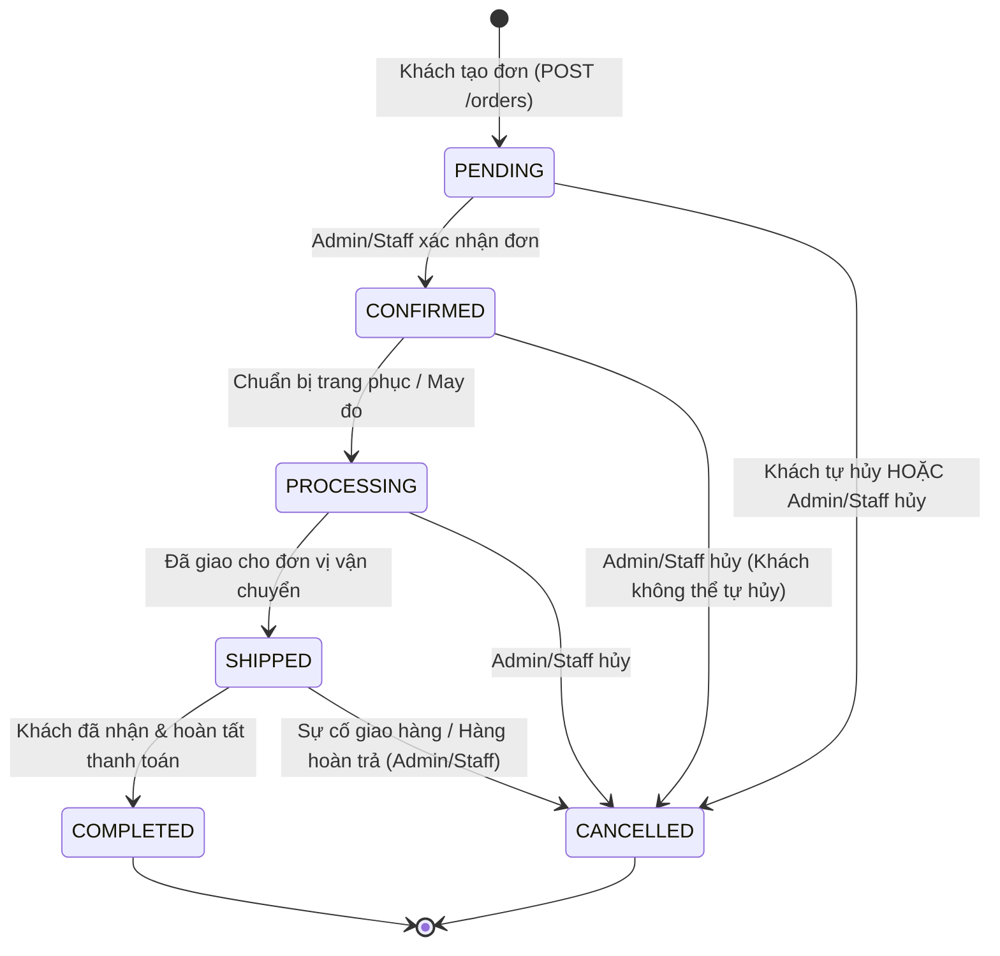

# Tài Liệu API Module Đơn Hàng (Orders Module API Specification)

> **Mục đích tài liệu:** Tài liệu này được biên soạn chuẩn hóa để cung cấp trực tiếp cho **AI (LLM / Copilot / Cursor / Claude / ChatGPT)** hoặc lập trình viên Frontend (FE) đọc hiểu và sinh mã nguồn giao diện (React, Next.js, Vue, Nuxt, React Native...) gọi đến Module Đơn hàng (`/api/v1/orders`) của hệ thống H'Mông Fashion.

---

## 📌 Hướng dẫn dành cho AI Lập trình Frontend (AI Prompting Context)

Khi sử dụng tài liệu này để lập trình Frontend, hãy tuân thủ các nguyên tắc sau:
1. **Base URL:** Mặc định `http://127.0.0.1:8000/api/v1/orders` (hoặc cấu hình qua biến môi trường `NEXT_PUBLIC_API_URL` / `VITE_API_BASE_URL` + `/api/v1/orders`).
2. **Cơ chế xác thực (Authentication):**
   - Đăng nhập xong, token được đính kèm ở Header: `Authorization: Bearer <access_token>`.
   - Các API có gắn nhãn `[Public]` hoặc `[Khách hàng / Vãng lai]` có thể gọi không cần Token.
   - API yêu cầu `[Tài khoản]` bắt buộc phải có Token; nếu không sẽ trả về `401 Unauthorized` (`TOKEN_MISSING` / `TOKEN_INVALID_OR_EXPIRED`).
   - API gắn nhãn `[Admin/Staff]` yêu cầu tài khoản có vai trò `ROLE_ADMIN` hoặc `ROLE_STAFF`.
3. **Xử lý Response & Error:**
   - Khi thành công: dữ liệu trả về trực tiếp đối tượng hoặc mảng JSON (không bọc qua tầng `{ data: ... }`).
   - Khi thất bại: Backend luôn trả về cấu trúc lỗi chuẩn `ErrorResponse` (xem chi tiết ở mục TypeScript). Luôn bóc tách `error.response?.data?.message` hoặc `error.response?.data?.detail` để hiển thị Toast thông báo cho người dùng.

---

## 📐 1. Hệ Thống Kiểu Dữ Liệu TypeScript (TypeScript Interfaces)

Hãy copy trực tiếp các type/interface dưới đây vào dự án Frontend (ví dụ `src/types/order.ts`):

```typescript
// ==============================================================================
// 1. ENUMS VÀ HẰNG SỐ NGHIỆP VỤ
// ==============================================================================

/** Loại đơn hàng */
export type OrderType = "BUY" | "RENT" | "TAILOR";

/** Phương thức thanh toán */
export type PaymentMethod = "COD" | "BANK_TRANSFER" | "VNPAY";

/** Trạng thái xử lý và vận chuyển của đơn hàng */
export type OrderStatus =
  | "PENDING"     // Chờ xác nhận
  | "CONFIRMED"   // Đã xác nhận
  | "PROCESSING"  // Đang xử lý / May đo / Chuẩn bị hàng
  | "SHIPPED"     // Đang vận chuyển
  | "COMPLETED"   // Hoàn tất đơn hàng
  | "CANCELLED";  // Đã hủy

/** Trạng thái thanh toán của đơn hàng */
export type PaymentStatus =
  | "PENDING"     // Chờ thanh toán
  | "PAID"        // Đã thanh toán thành công
  | "FAILED"      // Thanh toán thất bại
  | "REFUNDED";   // Đã hoàn tiền

// ==============================================================================
// 2. DATA MODELS VÀ REQUEST PAYLOADS
// ==============================================================================

/** Thực thể chi tiết đơn hàng trả về từ Backend */
export interface OrderResponse {
  id: number;
  user_id: number | null;
  order_code: string;         // Định dạng HMOOB-YYYYMMDD-XXXXXX (vd: HMOOB-20261113-A1B2C3)
  customer_name: string;      // Họ tên người nhận
  customer_phone: string;     // Số điện thoại nhận hàng
  shipping_address: string;   // Địa chỉ giao nhận hàng
  order_type: OrderType;      // BUY | RENT | TAILOR
  total_amount: number;       // Tổng giá trị đơn hàng (VNĐ)
  payment_method: PaymentMethod; // COD | BANK_TRANSFER | VNPAY
  payment_status: PaymentStatus; // PENDING | PAID | FAILED | REFUNDED
  status: OrderStatus;        // PENDING | CONFIRMED | PROCESSING | SHIPPED | COMPLETED | CANCELLED
  notes: string | null;       // Ghi chú đơn hàng (nếu có)
  created_at: string;         // ISO 8601 string (vd: "2026-11-13T07:20:00Z")
}

/** Payload tạo mới đơn hàng (POST /api/v1/orders/) */
export interface OrderCreatePayload {
  customer_name?: string;      // Bắt buộc với khách vãng lai. Nếu đã đăng nhập và để trống sẽ lấy từ profile
  customer_phone?: string;     // Bắt buộc với khách vãng lai. Nếu đã đăng nhập và để trống sẽ lấy từ user.phone
  shipping_address?: string;   // Bắt buộc với khách vãng lai. Nếu đã đăng nhập và để trống sẽ lấy từ profile.address
  order_type?: OrderType;      // Mặc định: "BUY"
  total_amount: number;        // Bắt buộc >= 0
  payment_method?: PaymentMethod; // Mặc định: "COD"
  notes?: string;              // Ghi chú đơn hàng từ khách
}

/** Payload cập nhật trạng thái đơn hàng dành cho Admin/Staff (PATCH /api/v1/orders/{order_id}) */
export interface OrderUpdateStatusPayload {
  status?: OrderStatus;
  payment_status?: PaymentStatus;
}

/** Tham số truy vấn danh sách đơn hàng (GET /api/v1/orders/) */
export interface OrderQueryParams {
  order_type?: OrderType;
  customer_phone?: string;     // Chỉ tài khoản ROLE_ADMIN / ROLE_STAFF mới có tác dụng
  skip?: number;               // Phân trang: vị trí bắt đầu (mặc định: 0)
  limit?: number;              // Phân trang: số lượng bản ghi (mặc định: 50, min: 1, max: 100)
}

// ==============================================================================
// 3. CẤU TRÚC PHẢN HỒI LỖI CHUẨN HOÁ (Standard Error Schema)
// ==============================================================================

export interface ErrorDetail {
  field?: string | null;       // Tên trường lỗi (vd: "total_amount", "customer_phone")
  location?: string | null;    // "body", "query", "path", "header"
  message: string;             // Mô tả chi tiết lỗi
  type?: string | null;        // Loại lỗi: "missing", "value_error", ...
}

export interface ApiErrorResponse {
  success: false;
  status_code: number;         // 400, 401, 403, 404, 422, 500
  error_code: string;          // INVALID_ORDER_TYPE, MISSING_CONTACT_INFO, ORDER_NOT_FOUND...
  message: string;             // Thông báo lỗi chính hiển thị cho người dùng
  detail?: string;             // Chuỗi thông báo tương thích ngược
  details?: ErrorDetail[];     // Danh sách lỗi chi tiết (nếu có, đặc biệt khi HTTP 422)
  timestamp: string;           // ISO 8601 UTC
  path: string;                // Đường dẫn API bị lỗi (vd: "/api/v1/orders/")
}
```

---

## 🔄 2. Sơ Đồ Vòng Đời Đơn Hàng & Luồng Nghiệp Vụ (State Flow)



### Quy Tắc Nghiệp Vụ Cần Chú Ý Khi Thiết Kế FE:
1. **Nút "Hủy đơn hàng" phía Khách hàng:**
   - Chỉ được kích hoạt hiển thị khi `order.status === "PENDING"`.
   - Nếu đơn hàng đã chuyển sang `CONFIRMED`, `PROCESSING`, `SHIPPED` hoặc `COMPLETED`, UI phía khách hàng phải ẩn hoặc disable nút này kèm tooltip: *"Đơn hàng đang xử lý, vui lòng liên hệ hotline hỗ trợ để hủy"*.
2. **Khách Đăng Nhập vs Khách Vãng Lai (Guest Checkout):**
   - **Khách đã đăng nhập:** FE có thể bỏ trống 3 trường `customer_name`, `customer_phone`, `shipping_address` trong payload; Backend sẽ tự động lấy từ User Profile. Tuy nhiên, FE nên ưu tiên prefill dữ liệu này từ API `/api/v1/auth/me` vào Form Checkout để người dùng có thể chỉnh sửa địa chỉ nhận hàng khác nếu muốn.
   - **Khách vãng lai (Chưa đăng nhập):** Bắt buộc người dùng phải điền đủ cả 3 trường `customer_name`, `customer_phone`, và `shipping_address`. Nếu thiếu, Backend trả về lỗi `400` với mã `MISSING_CONTACT_INFO`.
3. **Tra cứu đơn hàng không cần đăng nhập:**
   - Dùng mã `order_code` (dạng `HMOOB-20261113-XXXXXX`) được trả về lúc tạo đơn thành công.
   - Gọi API Public `/api/v1/orders/code/{order_code}`.

---

## 🚀 3. Danh Sách Chi Tiết Các Endpoint (API Endpoints)

| Method | Endpoint | Quyền hạn | Mục đích sử dụng trên Frontend |
| :--- | :--- | :--- | :--- |
| `POST` | `/api/v1/orders/` | Public / Khách hàng | Tạo đơn đặt mua / thuê / may đo mới |
| `GET` | `/api/v1/orders/` | Token Tài khoản | Lấy danh sách lịch sử đơn hàng (User chỉ thấy đơn của mình, Admin/Staff thấy tất cả) |
| `GET` | `/api/v1/orders/code/{order_code}` | Public | Tra cứu nhanh tiến độ đơn qua mã `HMOOB-...` |
| `GET` | `/api/v1/orders/{order_id}` | Token Tài khoản | Xem chi tiết 1 đơn hàng theo ID |
| `PATCH` | `/api/v1/orders/{order_id}` | Admin / Staff | Cập nhật trạng thái đơn hàng & trạng thái thanh toán |
| `POST` | `/api/v1/orders/{order_id}/cancel` | Token Tài khoản | Hủy đơn hàng (Khách hàng chỉ hủy khi PENDING; Staff/Admin có quyền hủy bất kỳ lúc nào) |

---

### 3.1. Tạo mới đơn hàng (Checkout / Place Order)

- **Đường dẫn:** `POST /api/v1/orders/`
- **Xác thực:** Tùy chọn (Optional). Có gửi Bearer Token thì tự động gán `user_id` và lấy thông tin hồ sơ; Không có gửi Token thì xử lý theo khách vãng lai.
- **Request Headers:**
  - `Content-Type: application/json`
  - `Authorization: Bearer <access_token>` *(Tùy chọn)*

#### Request Body (`OrderCreatePayload`):
```json
{
  "customer_name": "Lầu A Sùng",
  "customer_phone": "0987654321",
  "shipping_address": "Bản Cát Cát, Sa Pa, Lào Cai",
  "order_type": "BUY",
  "total_amount": 1250000,
  "payment_method": "COD",
  "notes": "Giao hàng vào giờ hành chính"
}
```

> **Ghi chú về các trường:**
> - `order_type`: Giá trị hợp lệ: `"BUY"`, `"RENT"`, `"TAILOR"` (không phân biệt hoa thường).
> - `payment_method`: Giá trị hợp lệ: `"COD"`, `"BANK_TRANSFER"`, `"VNPAY"` (không phân biệt hoa thường).
> - `total_amount`: Số thực >= 0 (đơn vị: VNĐ).
> - `notes`: Tùy chọn.

#### Phản hồi thành công (HTTP 201 Created):
```json
{
  "id": 12,
  "user_id": 5,
  "order_code": "HMOOB-20261113-8E5F2A",
  "customer_name": "Lầu A Sùng",
  "customer_phone": "0987654321",
  "shipping_address": "Bản Cát Cát, Sa Pa, Lào Cai",
  "order_type": "BUY",
  "total_amount": 1250000.0,
  "payment_method": "COD",
  "payment_status": "PENDING",
  "status": "PENDING",
  "notes": "Giao hàng vào giờ hành chính",
  "created_at": "2026-11-13T07:25:30.123456"
}
```

#### Các lỗi thường gặp (Error Responses):
- **400 Bad Request** (`MISSING_CONTACT_INFO`): Khi khách vãng lai (hoặc user chưa có profile) không điền đủ họ tên, SĐT hoặc địa chỉ.
  ```json
  {
    "success": false,
    "status_code": 400,
    "error_code": "MISSING_CONTACT_INFO",
    "message": "Vui lòng cung cấp đầy đủ họ tên (customer_name), số điện thoại (customer_phone) và địa chỉ nhận hàng (shipping_address) để chúng tôi liên hệ giao hàng.",
    "detail": "Vui lòng cung cấp đầy đủ họ tên (customer_name), số điện thoại (customer_phone) và địa chỉ nhận hàng (shipping_address) để chúng tôi liên hệ giao hàng.",
    "details": null,
    "timestamp": "2026-11-13T07:25:30.123456Z",
    "path": "/api/v1/orders/"
  }
  ```
- **400 Bad Request** (`INVALID_ORDER_TYPE`): Giá trị `order_type` không nằm trong danh sách cho phép (`BUY, RENT, TAILOR`).
- **400 Bad Request** (`INVALID_PAYMENT_METHOD`): Giá trị `payment_method` không nằm trong danh sách cho phép (`BANK_TRANSFER, COD, VNPAY`).
- **422 Unprocessable Entity** (`VALIDATION_ERROR`): Thiếu `total_amount` hoặc `total_amount < 0`.

---

### 3.2. Lấy danh sách đơn hàng (Order List / History)

- **Đường dẫn:** `GET /api/v1/orders/`
- **Xác thực:** Bắt buộc (`Authorization: Bearer <access_token>`).
- **Phân quyền Backend:**
  - Nếu là tài khoản Khách hàng (`ROLE_CUSTOMER`): Backend chỉ trả về danh sách đơn do chính khách đó đặt (`user_id == current_user.id`).
  - Nếu là Admin (`ROLE_ADMIN`) hoặc Staff (`ROLE_STAFF`): Backend trả về toàn bộ đơn trên hệ thống.

#### Query Parameters:
| Tên tham số | Kiểu | Mặc định | Ý nghĩa |
| :--- | :--- | :--- | :--- |
| `order_type` | `string` | `null` | Lọc theo loại đơn: `BUY`, `RENT`, `TAILOR` |
| `customer_phone` | `string` | `null` | Lọc theo số điện thoại nhận hàng (Chỉ Admin/Staff) |
| `skip` | `integer` | `0` | Vị trí offset phân trang (>= 0) |
| `limit` | `integer` | `50` | Giới hạn số bản ghi mỗi trang (min: 1, max: 100) |

#### Phản hồi thành công (HTTP 200 OK):
Trả về danh sách đơn hàng sắp xếp theo thứ tự mới nhất trước (`id DESC`):
```json
[
  {
    "id": 12,
    "user_id": 5,
    "order_code": "HMOOB-20261113-8E5F2A",
    "customer_name": "Lầu A Sùng",
    "customer_phone": "0987654321",
    "shipping_address": "Bản Cát Cát, Sa Pa, Lào Cai",
    "order_type": "BUY",
    "total_amount": 1250000.0,
    "payment_method": "COD",
    "payment_status": "PENDING",
    "status": "PENDING",
    "notes": "Giao hàng vào giờ hành chính",
    "created_at": "2026-11-13T07:25:30.123456"
  }
]
```

---

### 3.3. Tra cứu đơn hàng theo mã đơn (Public Tracking)

- **Đường dẫn:** `GET /api/v1/orders/code/{order_code}`
- **Xác thực:** Hoàn toàn Public (Không cần Token).
- **Mục đích Frontend:** Sử dụng cho trang tra cứu công khai (ví dụ `/tra-cuu-don-hang`), nơi khách hàng chỉ cần nhập mã vận đơn `HMOOB-...` để xem trạng thái giao nhận và tiến độ xử lý mà không cần đăng nhập.

#### Path Parameters:
- `order_code` (string): Mã đơn hàng, ví dụ: `HMOOB-20261113-8E5F2A`.

#### Phản hồi thành công (HTTP 200 OK):
Trả về đối tượng `OrderResponse`.

#### Lỗi thường gặp:
- **404 Not Found** (`ORDER_NOT_FOUND`): Khi không tìm thấy mã đơn hàng trong hệ thống.
  ```json
  {
    "success": false,
    "status_code": 404,
    "error_code": "ORDER_NOT_FOUND",
    "message": "Không tìm thấy đơn hàng với mã 'HMOOB-20261113-999999'.",
    "timestamp": "2026-11-13T07:30:00Z",
    "path": "/api/v1/orders/code/HMOOB-20261113-999999"
  }
  ```

---

### 3.4. Xem chi tiết đơn hàng theo ID (Order Detail)

- **Đường dẫn:** `GET /api/v1/orders/{order_id}`
- **Xác thực:** Bắt buộc (`Authorization: Bearer <access_token>`).
- **Phân quyền Backend:**
  - Khách hàng thường chỉ xem được đơn hàng của chính mình (`order.user_id === current_user.id`). Nếu xem đơn người khác -> Trả về `403 Forbidden` (`INSUFFICIENT_PERMISSIONS`).
  - Quản trị viên và Nhân viên có quyền xem chi tiết mọi đơn hàng.

#### Path Parameters:
- `order_id` (integer): ID đơn hàng.

#### Phản hồi thành công (HTTP 200 OK):
Trả về đối tượng `OrderResponse`.

---

### 3.5. Cập nhật trạng thái đơn hàng (Admin/Staff Update Status)

- **Đường dẫn:** `PATCH /api/v1/orders/{order_id}`
- **Xác thực:** Bắt buộc (`Authorization: Bearer <access_token>`).
- **Phân quyền Backend:** Chỉ tài khoản có vai trò `ROLE_ADMIN` hoặc `ROLE_STAFF` mới được phép gọi API này. Tài khoản khách hàng thông thường gọi vào sẽ bị từ chối `403 Forbidden` (`INSUFFICIENT_ROLE`).

#### Request Body (`OrderUpdateStatusPayload`):
*Tất cả các trường đều là tùy chọn; truyền trường nào sẽ cập nhật trường đó.*
```json
{
  "status": "CONFIRMED",
  "payment_status": "PAID"
}
```

> **Giá trị hợp lệ:**
> - `status`: `"PENDING"`, `"CONFIRMED"`, `"PROCESSING"`, `"SHIPPED"`, `"COMPLETED"`, `"CANCELLED"`
> - `payment_status`: `"PENDING"`, `"PAID"`, `"FAILED"`, `"REFUNDED"`

#### Phản hồi thành công (HTTP 200 OK):
Trả về đối tượng `OrderResponse` đã được cập nhật trạng thái mới.

#### Lỗi thường gặp:
- **400 Bad Request** (`INVALID_STATUS`): Trạng thái đơn truyền lên không hợp lệ.
- **400 Bad Request** (`INVALID_PAYMENT_STATUS`): Trạng thái thanh toán không hợp lệ.
- **403 Forbidden** (`INSUFFICIENT_ROLE`): Người gọi không có quyền Admin/Staff.
- **404 Not Found** (`ORDER_NOT_FOUND`): Không tồn tại đơn hàng với ID đã cho.

---

### 3.6. Hủy đơn hàng (Cancel Order)

- **Đường dẫn:** `POST /api/v1/orders/{order_id}/cancel`
- **Xác thực:** Bắt buộc (`Authorization: Bearer <access_token>`).
- **Nghiệp vụ chi tiết:**
  - **Khách hàng thường:**
    - Chỉ được phép hủy đơn hàng của chính mình.
    - Đơn hàng **bắt buộc phải đang ở trạng thái `PENDING`**.
    - Nếu đơn đã sang `CONFIRMED` / `PROCESSING` / `SHIPPED` / `COMPLETED`, Backend sẽ trả về `400 Bad Request` với mã lỗi `ORDER_CANNOT_BE_CANCELLED`.
  - **Admin / Staff:** Có thể hỗ trợ hủy đơn hàng ở các giai đoạn trước khi hoàn tất.

#### Phản hồi thành công (HTTP 200 OK):
Trả về đối tượng `OrderResponse` với `status: "CANCELLED"`.

#### Lỗi thường gặp:
- **400 Bad Request** (`ORDER_CANNOT_BE_CANCELLED`):
  ```json
  {
    "success": false,
    "status_code": 400,
    "error_code": "ORDER_CANNOT_BE_CANCELLED",
    "message": "Đơn hàng đang được xử lý hoặc đã hoàn tất, không thể tự hủy. Vui lòng liên hệ nhân viên.",
    "timestamp": "2026-11-13T07:35:00Z",
    "path": "/api/v1/orders/12/cancel"
  }
  ```
- **403 Forbidden** (`INSUFFICIENT_PERMISSIONS`): Cố tình hủy đơn hàng của tài khoản khác.
- **404 Not Found** (`ORDER_NOT_FOUND`): Không tìm thấy đơn hàng.

---

## 💻 4. Code Mẫu Tích Hợp Frontend (Production-Ready Code Snippets)

Dưới đây là mã nguồn TypeScript hoàn chỉnh dùng thư viện `axios` để tích hợp vào ứng dụng Frontend React / Next.js.

### 4.1. File Service Gọi API (`src/services/orderService.ts`)

```typescript
import axios, { AxiosError } from "axios";
import {
  ApiErrorResponse,
  OrderCreatePayload,
  OrderQueryParams,
  OrderResponse,
  OrderUpdateStatusPayload,
} from "@/types/order";

// Khởi tạo instance Axios
const apiClient = axios.create({
  baseURL: process.env.NEXT_PUBLIC_API_URL || "http://127.0.0.1:8000/api/v1",
  headers: {
    "Content-Type": "application/json",
  },
});

// Interceptor tự động gắn Access Token từ LocalStorage/Cookie
apiClient.interceptors.request.use((config) => {
  if (typeof window !== "undefined") {
    const token = localStorage.getItem("access_token");
    if (token) {
      config.headers.Authorization = `Bearer ${token}`;
    }
  }
  return config;
});

// Helper xử lý lỗi chuẩn hoá
export const extractErrorMessage = (error: unknown): string => {
  if (axios.isAxiosError(error)) {
    const axiosError = error as AxiosError<ApiErrorResponse>;
    const errorData = axiosError.response?.data;
    if (errorData?.message) return errorData.message;
    if (errorData?.detail) return errorData.detail;
    return `Lỗi máy chủ (${axiosError.response?.status || 500})`;
  }
  return (error as Error).message || "Đã xảy ra lỗi không xác định";
};

// ==============================================================================
// ORDER SERVICE APIS
// ==============================================================================

export const orderService = {
  /**
   * Tạo đơn hàng mới (Khách vãng lai hoặc Khách đã đăng nhập)
   */
  createOrder: async (payload: OrderCreatePayload): Promise<OrderResponse> => {
    const response = await apiClient.post<OrderResponse>("/orders/", payload);
    return response.data;
  },

  /**
   * Lấy danh sách lịch sử đơn hàng của tài khoản hiện tại
   */
  getMyOrders: async (params?: OrderQueryParams): Promise<OrderResponse[]> => {
    const response = await apiClient.get<OrderResponse[]>("/orders/", { params });
    return response.data;
  },

  /**
   * Tra cứu đơn hàng công khai theo mã vận đơn HMOOB-
   */
  getOrderByCode: async (orderCode: string): Promise<OrderResponse> => {
    const cleanCode = encodeURIComponent(orderCode.trim());
    const response = await apiClient.get<OrderResponse>(`/orders/code/${cleanCode}`);
    return response.data;
  },

  /**
   * Xem chi tiết đơn hàng theo ID
   */
  getOrderById: async (orderId: number): Promise<OrderResponse> => {
    const response = await apiClient.get<OrderResponse>(`/orders/${orderId}`);
    return response.data;
  },

  /**
   * Khách hàng hoặc Admin hủy đơn hàng
   */
  cancelOrder: async (orderId: number): Promise<OrderResponse> => {
    const response = await apiClient.post<OrderResponse>(`/orders/${orderId}/cancel`);
    return response.data;
  },

  /**
   * Admin / Staff cập nhật trạng thái đơn và thanh toán
   */
  updateOrderStatus: async (
    orderId: number,
    payload: OrderUpdateStatusPayload
  ): Promise<OrderResponse> => {
    const response = await apiClient.patch<OrderResponse>(`/orders/${orderId}`, payload);
    return response.data;
  },
};
```

---

### 4.2. Custom Hook React Query (`src/hooks/useOrders.ts`)

```typescript
import { useMutation, useQuery, useQueryClient } from "@tanstack/react-query";
import { orderService, extractErrorMessage } from "@/services/orderService";
import { OrderCreatePayload, OrderQueryParams, OrderUpdateStatusPayload } from "@/types/order";
import { toast } from "react-toastify"; // Hoặc sonner, react-hot-toast, ant-design message

/** Hook lấy danh sách đơn hàng */
export const useOrders = (params?: OrderQueryParams) => {
  return useQuery({
    queryKey: ["orders", params],
    queryFn: () => orderService.getMyOrders(params),
  });
};

/** Hook tra cứu đơn hàng theo mã */
export const useOrderByCode = (orderCode: string, enabled = true) => {
  return useQuery({
    queryKey: ["order_by_code", orderCode],
    queryFn: () => orderService.getOrderByCode(orderCode),
    enabled: Boolean(orderCode) && enabled,
    retry: false,
  });
};

/** Hook tạo đơn hàng mới */
export const useCreateOrder = () => {
  const queryClient = useQueryClient();
  return useMutation({
    mutationFn: (payload: OrderCreatePayload) => orderService.createOrder(payload),
    onSuccess: (data) => {
      toast.success(`Đặt hàng thành công! Mã đơn: ${data.order_code}`);
      queryClient.invalidateQueries({ queryKey: ["orders"] });
    },
    onError: (error) => {
      toast.error(extractErrorMessage(error));
    },
  });
};

/** Hook hủy đơn hàng */
export const useCancelOrder = () => {
  const queryClient = useQueryClient();
  return useMutation({
    mutationFn: (orderId: number) => orderService.cancelOrder(orderId),
    onSuccess: (data) => {
      toast.success(`Đã hủy thành công đơn hàng ${data.order_code}`);
      queryClient.invalidateQueries({ queryKey: ["orders"] });
      queryClient.invalidateQueries({ queryKey: ["order", data.id] });
    },
    onError: (error) => {
      toast.error(extractErrorMessage(error));
    },
  });
};

/** Hook cập nhật trạng thái dành cho Admin/Staff */
export const useUpdateOrderStatus = (orderId: number) => {
  const queryClient = useQueryClient();
  return useMutation({
    mutationFn: (payload: OrderUpdateStatusPayload) =>
      orderService.updateOrderStatus(orderId, payload),
    onSuccess: (data) => {
      toast.success(`Cập nhật trạng thái đơn ${data.order_code} thành công`);
      queryClient.invalidateQueries({ queryKey: ["orders"] });
      queryClient.invalidateQueries({ queryKey: ["order", orderId] });
    },
    onError: (error) => {
      toast.error(extractErrorMessage(error));
    },
  });
};
```

---

## 🎨 5. Bản Đồ Trực Quan Trạng Thái & Màu Sắc Giao Diện (UI Color Mapping)

Khi AI sinh giao diện UI hiển thị Badge / Tag trạng thái, hãy dùng bảng ánh xạ màu và text sau:

```typescript
export const ORDER_STATUS_CONFIG: Record<
  string,
  { label: string; color: string; badgeClass: string }
> = {
  PENDING: {
    label: "Chờ xác nhận",
    color: "#eab308",
    badgeClass: "bg-yellow-100 text-yellow-800 border-yellow-300",
  },
  CONFIRMED: {
    label: "Đã xác nhận",
    color: "#3b82f6",
    badgeClass: "bg-blue-100 text-blue-800 border-blue-300",
  },
  PROCESSING: {
    label: "Đang may / Xử lý",
    color: "#a855f7",
    badgeClass: "bg-purple-100 text-purple-800 border-purple-300",
  },
  SHIPPED: {
    label: "Đang giao hàng",
    color: "#06b6d4",
    badgeClass: "bg-cyan-100 text-cyan-800 border-cyan-300",
  },
  COMPLETED: {
    label: "Hoàn tất",
    color: "#22c55e",
    badgeClass: "bg-green-100 text-green-800 border-green-300",
  },
  CANCELLED: {
    label: "Đã hủy",
    color: "#ef4444",
    badgeClass: "bg-red-100 text-red-800 border-red-300",
  },
};

export const PAYMENT_STATUS_CONFIG: Record<
  string,
  { label: string; badgeClass: string }
> = {
  PENDING: {
    label: "Chưa thanh toán",
    badgeClass: "bg-gray-100 text-gray-700",
  },
  PAID: {
    label: "Đã thanh toán",
    badgeClass: "bg-emerald-100 text-emerald-800",
  },
  FAILED: {
    label: "Thất bại",
    badgeClass: "bg-rose-100 text-rose-800",
  },
  REFUNDED: {
    label: "Đã hoàn tiền",
    badgeClass: "bg-amber-100 text-amber-800",
  },
};
```

---

## 📋 6. Checklist Kiểm Thử Frontend Khi Gọi Module Orders

- [ ] **Checkout vãng lai:** Thử gửi request thiếu 1 trong 3 thông tin `customer_name`, `customer_phone`, `shipping_address` -> Kiểm tra xem Form có hiển thị thông báo lỗi `MISSING_CONTACT_INFO` hợp lý hay không.
- [ ] **Checkout tài khoản đã đăng nhập:** Đăng nhập, mở trang Checkout -> Kiểm tra xem thông tin người nhận có được tự động điền sẵn (prefill) từ `user.profile` hay không.
- [ ] **Tra cứu đơn Public:** Nhập mã `HMOOB-YYYYMMDD-XXXXXX` vào ô tìm kiếm -> Xem trạng thái đơn hàng mà không bị hỏi token đăng nhập.
- [ ] **Nút Hủy đơn hàng:**
  - Nếu đơn là `PENDING` -> Nút "Hủy đơn" hiển thị và click được -> Gọi API và cập nhật giao diện sang `CANCELLED`.
  - Nếu đơn đã là `CONFIRMED` / `SHIPPED` -> Nút "Hủy đơn" bị ẩn hoặc disable.
- [ ] **Admin Portal:** Dùng tài khoản `admin` / `nhanvien1` để kiểm tra chức năng lọc danh sách theo `customer_phone` và đổi `status` / `payment_status`.
