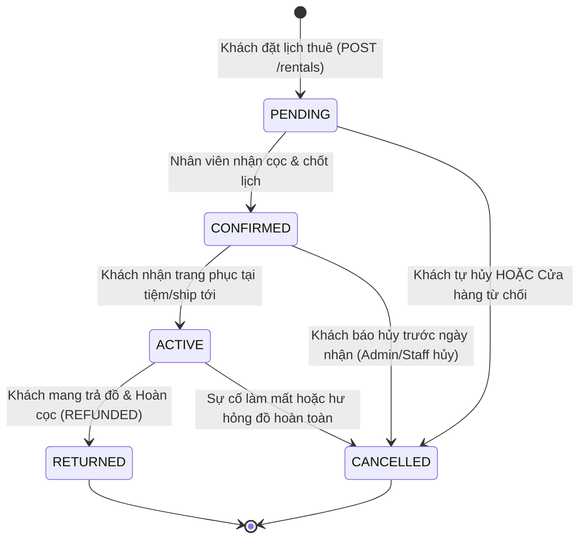

# Tài Liệu API Module Cho Thuê Trang Phục (Rentals Module API Specification)

> **Mục đích tài liệu:** Tài liệu này được biên soạn chuẩn hóa để cung cấp trực tiếp cho **AI (LLM / Copilot / Cursor / Claude / ChatGPT)** hoặc lập trình viên Frontend (FE) đọc hiểu và sinh mã nguồn giao diện: Lịch chọn ngày thuê & kiểm tra phòng/đồ trống (Date Range Picker & Availability Checker), Đặt thuê trang phục (Booking Checkout), Tra cứu đơn thuê theo mã `RENT-...`, Quản lý lịch sử thuê đồ của khách và Bảng điều khiển quản lý lịch thuê/tiền cọc cho nhân viên cửa hàng.

---

## 📌 Hướng dẫn dành cho AI Lập trình Frontend (AI Prompting Context)

1. **Base URL:** `http://127.0.0.1:8000/api/v1/rentals`
2. **Quy tắc tính ngày thuê & Giá tiền:**
   - Số ngày thuê tính bao gồm cả ngày bắt đầu và ngày kết thúc: `days = (end_date - start_date).days + 1`.
   - Nếu Frontend để `total_price: 0`, Backend sẽ tự động nhân: `total_price = days * product.rental_price_per_day`.
   - `start_date` bắt buộc phải nhỏ hơn hoặc bằng `end_date` (định dạng chuẩn `YYYY-MM-DD`).
3. **Cơ chế Khóa Giữ Chỗ Tạm Thời (Redis Slot Lock):**
   - Khi khách hàng nhấn "Đặt thuê", Backend sẽ kiểm tra trùng lịch trong Database và đặt một khóa tạm thời Redis Lock (thời gian giữ chỗ 5 phút / 300 giây).
   - Nếu trong lúc đó có người khác đang trong quá trình thanh toán cùng khung giờ, Backend trả về `429 Too Many Requests` (`RENTAL_SLOT_LOCKED`). FE cần hiển thị thông báo: *"Khung giờ này đang có người giữ chỗ thanh toán, vui lòng thử lại sau 5 phút"*.
4. **Tra cứu không cần đăng nhập:**
   - Khách có thể tra cứu đơn thuê bằng mã `RENT-YYYYMMDD-XXXXXX` thông qua API công khai `GET /api/v1/rentals/code/{booking_code}`.

---

## 📐 1. Hệ Thống Kiểu Dữ Liệu TypeScript (TypeScript Interfaces)

Hãy copy trực tiếp các type/interface dưới đây vào `src/types/rental.ts`:

```typescript
// ==============================================================================
// 1. ENUMS VÀ TRẠNG THÁI NGHIỆP VỤ THUÊ ĐỒ
// ==============================================================================

/** Trạng thái tiến trình thuê đồ */
export type RentalStatus =
  | "PENDING"     // Chờ cửa hàng duyệt & yêu cầu đặt cọc
  | "CONFIRMED"   // Đã duyệt lịch thuê & đã chốt tiền cọc
  | "ACTIVE"      // Khách hàng đang nhận và sử dụng đồ thuê
  | "RETURNED"    // Khách đã trả lại đồ nguyên vẹn cho cửa hàng
  | "CANCELLED";  // Đơn thuê đã bị hủy

/** Trạng thái tiền cọc trang phục */
export type DepositStatus =
  | "PENDING_DEPOSIT" // Chờ khách chuyển khoản hoặc nộp cọc
  | "DEPOSITED"       // Cửa hàng đã nhận đủ tiền cọc
  | "REFUNDED";       // Cửa hàng đã hoàn lại cọc sau khi kiểm tra đồ trả

// ==============================================================================
// 2. DATA MODELS VÀ REQUEST PAYLOADS
// ==============================================================================

export interface RentalBookingResponse {
  id: number;
  booking_code: string;        // Định dạng RENT-YYYYMMDD-XXXX (vd: RENT-20261113-A7B2)
  user_id: number | null;
  product_id: number;
  customer_name: string;
  customer_phone: string;
  start_date: string;          // "YYYY-MM-DD"
  end_date: string;            // "YYYY-MM-DD"
  total_price: number;         // Tổng chi phí thuê (VNĐ)
  deposit_amount: number;      // Tiền đặt cọc trang phục (VNĐ)
  deposit_status: DepositStatus;
  status: RentalStatus;
  staff_notes: string | null;  // Ghi chú của nhân viên về tình trạng đồ hoặc phụ kiện kèm theo
  created_at: string;          // ISO 8601 string
  updated_at: string | null;
}

/** Payload kiểm tra lịch trống (POST /check-availability) */
export interface RentalAvailabilityCheckPayload {
  product_id: number;
  start_date: string;          // "YYYY-MM-DD"
  end_date: string;            // "YYYY-MM-DD"
}

export interface RentalAvailabilityResponse {
  product_id: number;
  is_available: boolean;       // true nếu còn lịch trống
  message: string;             // Thông báo gợi ý hiển thị trên giao diện
}

/** Payload gửi yêu cầu đặt thuê (POST /api/v1/rentals/) */
export interface RentalBookingCreatePayload {
  product_id: number;
  customer_name?: string;      // Bắt buộc nếu là khách vãng lai (chưa đăng nhập)
  customer_phone?: string;     // Bắt buộc nếu là khách vãng lai (chưa đăng nhập)
  start_date: string;          // "YYYY-MM-DD"
  end_date: string;            // "YYYY-MM-DD"
  total_price?: number;        // Nếu truyền 0, Backend tự tính theo đơn giá/ngày
  deposit_amount?: number;     // Tiền cọc mong muốn (tùy chọn)
}

/** Payload Admin/Staff cập nhật trạng thái đơn thuê (PATCH /{booking_id}/status) */
export interface RentalBookingUpdateStatusPayload {
  status?: RentalStatus;
  deposit_amount?: number;
  deposit_status?: DepositStatus;
  staff_notes?: string;
}

/** Tham số bộ lọc danh sách thuê */
export interface RentalQueryParams {
  product_id?: number;
  order_status?: RentalStatus;
  customer_phone?: string;     // Chỉ tài khoản Admin/Staff
  skip?: number;
  limit?: number;
}
```

---

## 🔄 2. Sơ Đồ Trạng Thái Thuê Trang Phục (Rental State Machine)



---

## 🚀 3. Danh Sách Các Endpoint Module Rentals (`/api/v1/rentals`)

| Method | Endpoint | Quyền hạn | Mục đích sử dụng trên Frontend |
| :--- | :--- | :--- | :--- |
| `POST` | `/api/v1/rentals/check-availability` | Public | Kiểm tra xem sản phẩm có trống lịch trong khoảng ngày chọn hay không |
| `POST` | `/api/v1/rentals/` | Public / Khách hàng | Tạo đơn đặt thuê đồ (Kèm khóa giữ chỗ tạm thời) |
| `GET` | `/api/v1/rentals/code/{booking_code}` | Public | Tra cứu tiến độ đơn thuê bằng mã `RENT-...` |
| `GET` | `/api/v1/rentals/` | Token Tài khoản | Danh sách lịch thuê (User xem lịch của mình, Admin/Staff xem toàn bộ) |
| `GET` | `/api/v1/rentals/{booking_id}` | Token Tài khoản | Chi tiết lịch thuê theo ID |
| `PATCH` | `/api/v1/rentals/{booking_id}/status` | Admin / Staff | Cập nhật duyệt đơn, ghi nhận tiền cọc & tình trạng đồ |
| `POST` | `/api/v1/rentals/{booking_id}/cancel` | Token Tài khoản | Hủy lịch thuê (Khách chỉ hủy khi PENDING) |

---

### 3.1. Kiểm tra lịch trống (`POST /api/v1/rentals/check-availability`)

- **Xác thực:** Public (Khách xem lịch trước khi quyết định thuê).
- **Request Body (`RentalAvailabilityCheckPayload`):**
  ```json
  {
    "product_id": 1,
    "start_date": "2026-12-01",
    "end_date": "2026-12-03"
  }
  ```
- **Phản hồi khi còn lịch (HTTP 200 OK):**
  ```json
  {
    "product_id": 1,
    "is_available": true,
    "message": "Lịch thuê còn trống, có thể đặt lịch."
  }
  ```
- **Phản hồi khi đã trùng lịch (HTTP 200 OK):**
  ```json
  {
    "product_id": 1,
    "is_available": false,
    "message": "Sản phẩm đã có lịch thuê trong khoảng thời gian này."
  }
  ```

---

### 3.2. Đặt thuê trang phục (`POST /api/v1/rentals/`)

- **Xác thực:** Tùy chọn (Nếu có Token tự lấy họ tên & SĐT từ profile; Nếu chưa đăng nhập thì bắt buộc điền).
- **Request Body (`RentalBookingCreatePayload`):**
  ```json
  {
    "product_id": 1,
    "customer_name": "Lò Thị Mai",
    "customer_phone": "0912345678",
    "start_date": "2026-12-01",
    "end_date": "2026-12-03",
    "total_price": 0,
    "deposit_amount": 500000
  }
  ```
- **Phản hồi thành công (HTTP 201 Created):**
  ```json
  {
    "id": 8,
    "booking_code": "RENT-20261113-F3D1",
    "user_id": 5,
    "product_id": 1,
    "customer_name": "Lò Thị Mai",
    "customer_phone": "0912345678",
    "start_date": "2026-12-01",
    "end_date": "2026-12-03",
    "total_price": 1050000.0,
    "deposit_amount": 500000.0,
    "deposit_status": "PENDING_DEPOSIT",
    "status": "PENDING",
    "staff_notes": null,
    "created_at": "2026-11-13T07:40:00Z",
    "updated_at": null
  }
  ```
- **Lỗi thường gặp:**
  - `400 Bad Request` (`INVALID_DATE_RANGE`): `start_date > end_date`.
  - `400 Bad Request` (`PRODUCT_NOT_FOR_RENT`): Sản phẩm không hỗ trợ thuê hoặc `rental_price_per_day <= 0`.
  - `409 Conflict` (`RENTAL_SCHEDULE_CONFLICT`): Đã có người đặt thuê trùng khoảng ngày này.
  - `429 Too Many Requests` (`RENTAL_SLOT_LOCKED`): Có người khác đang giữ chỗ thanh toán.

---

### 3.3. Tra cứu đơn thuê theo mã (`GET /api/v1/rentals/code/{booking_code}`)

- **Xác thực:** Public.
- **Path Param:** `booking_code` (vd: `RENT-20261113-F3D1`).
- **Phản hồi:** Đối tượng `RentalBookingResponse`.

---

### 3.4. Cập nhật trạng thái đơn thuê & tiền cọc (`PATCH /api/v1/rentals/{booking_id}/status`)

- **Xác thực:** Bắt buộc (`ROLE_ADMIN` hoặc `ROLE_STAFF`).
- **Request Body (`RentalBookingUpdateStatusPayload`):**
  ```json
  {
    "status": "CONFIRMED",
    "deposit_amount": 500000,
    "deposit_status": "DEPOSITED",
    "staff_notes": "Đã nhận cọc chuyển khoản qua ngân hàng. Kèm 1 thắt lưng vải và 1 khăn đội đầu."
  }
  ```
- **Phản hồi:** Đối tượng `RentalBookingResponse` đã cập nhật.

---

### 3.5. Hủy yêu cầu thuê (`POST /api/v1/rentals/{booking_id}/cancel`)

- **Xác thực:** Bắt buộc (`Authorization: Bearer <access_token>`).
- **Nghiệp vụ:** Khách hàng chỉ được hủy khi đơn ở trạng thái `PENDING`. Nhân viên có thể hỗ trợ hủy trước khi giao đồ.
- **Phản hồi:** Đối tượng `RentalBookingResponse` với `status: "CANCELLED"`.

---

## 💻 4. Code Mẫu Tích Hợp Frontend (Rental Booking Service)

```typescript
import axios from "axios";
import {
  RentalAvailabilityCheckPayload,
  RentalAvailabilityResponse,
  RentalBookingCreatePayload,
  RentalBookingResponse,
  RentalBookingUpdateStatusPayload,
  RentalQueryParams,
} from "@/types/rental";

const API_BASE_URL = process.env.NEXT_PUBLIC_API_URL || "http://127.0.0.1:8000/api/v1";

export const rentalService = {
  /**
   * Kiểm tra xem sản phẩm có trống lịch không
   */
  checkAvailability: async (
    payload: RentalAvailabilityCheckPayload
  ): Promise<RentalAvailabilityResponse> => {
    const res = await axios.post<RentalAvailabilityResponse>(
      `${API_BASE_URL}/rentals/check-availability`,
      payload
    );
    return res.data;
  },

  /**
   * Gửi yêu cầu đặt thuê trang phục
   */
  createBooking: async (
    payload: RentalBookingCreatePayload,
    token?: string
  ): Promise<RentalBookingResponse> => {
    const headers: Record<string, string> = {};
    if (token) headers.Authorization = `Bearer ${token}`;

    const res = await axios.post<RentalBookingResponse>(
      `${API_BASE_URL}/rentals/`,
      payload,
      { headers }
    );
    return res.data;
  },

  /**
   * Tra cứu công khai theo mã RENT-...
   */
  getBookingByCode: async (bookingCode: string): Promise<RentalBookingResponse> => {
    const cleanCode = encodeURIComponent(bookingCode.trim());
    const res = await axios.get<RentalBookingResponse>(
      `${API_BASE_URL}/rentals/code/${cleanCode}`
    );
    return res.data;
  },

  /**
   * Lấy danh sách lịch thuê của tôi
   */
  getMyRentals: async (
    params: RentalQueryParams,
    token: string
  ): Promise<RentalBookingResponse[]> => {
    const res = await axios.get<RentalBookingResponse[]>(`${API_BASE_URL}/rentals/`, {
      params,
      headers: { Authorization: `Bearer ${token}` },
    });
    return res.data;
  },

  /**
   * Hủy đơn thuê
   */
  cancelBooking: async (bookingId: number, token: string): Promise<RentalBookingResponse> => {
    const res = await axios.post<RentalBookingResponse>(
      `${API_BASE_URL}/rentals/${bookingId}/cancel`,
      {},
      { headers: { Authorization: `Bearer ${token}` } }
    );
    return res.data;
  },

  /**
   * Admin/Staff cập nhật trạng thái đơn & cọc
   */
  updateRentalStatus: async (
    bookingId: number,
    payload: RentalBookingUpdateStatusPayload,
    token: string
  ): Promise<RentalBookingResponse> => {
    const res = await axios.patch<RentalBookingResponse>(
      `${API_BASE_URL}/rentals/${bookingId}/status`,
      payload,
      { headers: { Authorization: `Bearer ${token}` } }
    );
    return res.data;
  },
};
```
