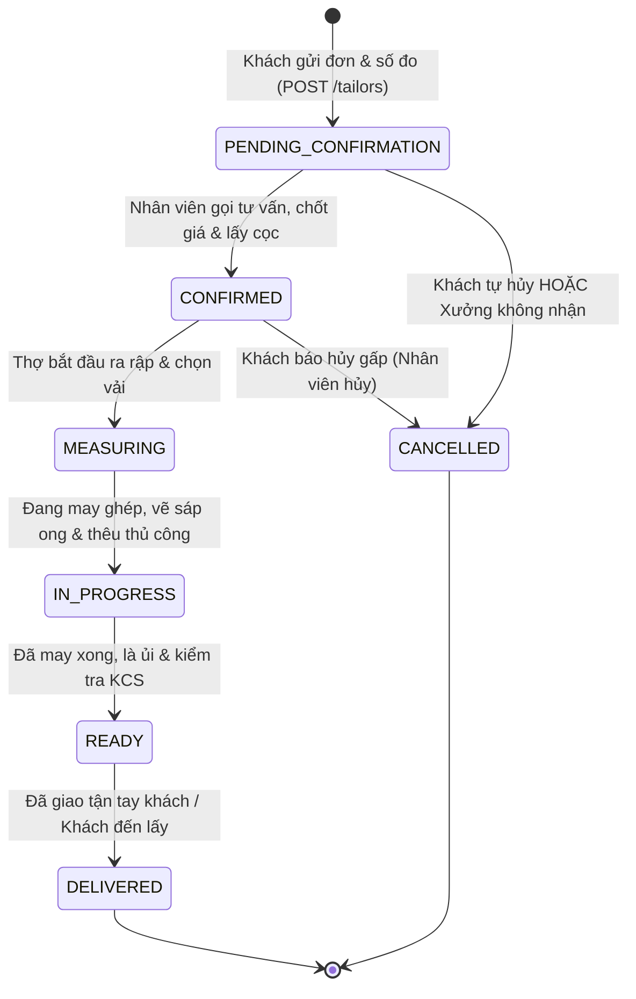

# Tài Liệu API Module May Đo Theo Yêu Cầu (Tailors Module API Specification)

> **Mục đích tài liệu:** Tài liệu này được biên soạn chuẩn hóa để cung cấp trực tiếp cho **AI (LLM / Copilot / Cursor / Claude / ChatGPT)** hoặc lập trình viên Frontend (FE) đọc hiểu và sinh mã nguồn giao diện: Form gửi yêu cầu may đo trang phục H'Mông theo số đo 3 vòng, tải lên ảnh mẫu thiết kế mong muốn, tra cứu tiến độ may đo theo mã `TAILOR-...`, xem lịch sử may đo của khách và bảng quản lý tiếp nhận/chốt giá/cập nhật tiến độ xưởng may cho nhân viên.

---

## 📌 Hướng dẫn dành cho AI Lập trình Frontend (AI Prompting Context)

1. **Base URL:** `http://127.0.0.1:8000/api/v1/tailors`
2. **Quy trình may đo trang phục H'Mông:**
   - **Bước 1 (Khách gửi yêu cầu):** Khách hàng điền họ tên, SĐT, địa chỉ, chọn mẫu thiết kế (`design_code`), tải ảnh mẫu (`design_image_url` - upload qua `/api/v1/media/upload`), nhập chiều cao, cân nặng và số đo cơ thể (`measurements`).
   - **Bước 2 (Chờ xác nhận):** Đơn tạo thành công với mã `TAILOR-YYYYMMDD-XXXX` và trạng thái ban đầu là `PENDING_CONFIRMATION`.
   - **Bước 3 (Nhân viên tư vấn & Chốt cọc):** Nhân viên xưởng may gọi điện tư vấn chất liệu thổ cẩm, sáp ong, hạt cườm, chốt giá chính thức (`estimated_price`) và nhận tiền cọc (`deposit_amount`, `deposit_status: DEPOSITED`).
   - **Bước 4 (May đo & Giao hàng):** Nhân viên cập nhật tiến độ lần lượt qua các khâu: `MEASURING` (Đo đạc) -> `IN_PROGRESS` (Đang may thêu) -> `READY` (Hoàn thiện sẵn sàng) -> `DELIVERED` (Đã giao khách).
3. **Quyền Hủy Đơn:**
   - Khách hàng chỉ có thể tự hủy đơn khi đơn vẫn đang ở trạng thái chờ liên hệ: `PENDING_CONFIRMATION`.
   - Khi đơn đã chuyển sang `CONFIRMED` trở đi, FE phải ẩn/disable nút Hủy và hướng dẫn khách gọi hotline.

---

## 📐 1. Hệ Thống Kiểu Dữ Liệu TypeScript (TypeScript Interfaces)

Hãy copy trực tiếp các type/interface dưới đây vào `src/types/tailor.ts`:

```typescript
// ==============================================================================
// 1. ENUMS VÀ TRẠNG THÁI TIẾN ĐỘ MAY ĐO
// ==============================================================================

export type TailorOrderStatus =
  | "PENDING_CONFIRMATION" // Chờ nhân viên xưởng gọi điện tư vấn & xác nhận
  | "CONFIRMED"            // Đã xác nhận mẫu & thỏa thuận xong giá
  | "MEASURING"            // Thợ may đang cắt rập theo thông số
  | "IN_PROGRESS"          // Đang tiến hành may, dệt thổ cẩm, thêu hoa văn
  | "READY"                // Trang phục đã may xong, sẵn sàng đóng gói
  | "DELIVERED"            // Đã giao tận tay cho khách hàng
  | "CANCELLED";           // Đã hủy

export type TailorDepositStatus =
  | "PENDING_DEPOSIT"      // Chờ đặt cọc
  | "DEPOSITED"            // Đã nộp/chuyển khoản cọc
  | "REFUNDED";            // Đã hoàn cọc

// ==============================================================================
// 2. DATA MODELS & SCHEMAS
// ==============================================================================

/** Chi tiết thông số số đo cơ thể */
export interface MeasurementDetail {
  height?: number;         // Chiều cao (cm, từ 50 đến 250)
  weight?: number;         // Cân nặng (kg, từ 20 đến 300)
  bust?: number;           // Vòng 1 - ngực (cm, từ 40 đến 200)
  waist?: number;          // Vòng 2 - eo (cm, từ 30 đến 200)
  hips?: number;           // Vòng 3 - mông (cm, từ 40 đến 200)
  shoulder_width?: number; // Rộng vai (cm)
  arm_length?: number;     // Dài tay áo (cm)
  dress_length?: number;   // Dài áo hoặc váy (cm)
  extra_notes?: string;    // Dáng người (dáng quả lê, đồng hồ cát, lưng dài...)
}

export interface TailorOrderResponse {
  id: number;
  order_code: string;           // Định dạng TAILOR-YYYYMMDD-XXXX (vd: TAILOR-20261113-B8E2)
  user_id: number | null;
  customer_name: string;
  customer_phone: string;
  customer_address: string | null;
  design_code: string;          // Tên mẫu hoặc mã mẫu (vd: "HMONG_DEN_SAPA_01")
  design_image_url: string | null;
  measurements: Record<string, any>; // Chứa JSON số đo cơ thể
  notes: string | null;         // Yêu cầu riêng về hoa văn, màu sắc vải
  estimated_price: number;      // Giá may chính thức (VNĐ)
  deposit_amount: number;       // Số tiền cọc đã thu (VNĐ)
  deposit_status: TailorDepositStatus;
  status: TailorOrderStatus;
  staff_notes: string | null;   // Ghi chú của thợ may / nhân viên
  created_at: string;           // ISO 8601 string
  updated_at: string | null;
}

/** Payload tạo đơn may đo mới */
export interface TailorOrderCreatePayload {
  customer_name?: string;       // Bắt buộc nếu là khách vãng lai
  customer_phone?: string;      // Bắt buộc nếu là khách vãng lai
  customer_address?: string;
  height?: number;              // Chiều cao (cm)
  weight?: number;              // Cân nặng (kg)
  design_code: string;          // Bắt buộc (tên hoặc mã mẫu thiết kế)
  design_image_url?: string;    // URL ảnh mẫu đính kèm nếu có
  measurements?: MeasurementDetail;
  notes?: string;               // Yêu cầu chi tiết về hoa văn, thắt lưng, nút áo
}

/** Payload cập nhật trạng thái đơn may đo (Dành cho Admin / Staff) */
export interface TailorOrderUpdateStatusPayload {
  status?: TailorOrderStatus;
  deposit_amount?: number;
  deposit_status?: TailorDepositStatus;
  estimated_price?: number;
  staff_notes?: string;
}

/** Tham số lọc danh sách đơn may đo */
export interface TailorQueryParams {
  design_code?: string;
  order_status?: TailorOrderStatus;
  customer_phone?: string;      // Chỉ áp dụng cho Staff/Admin
  skip?: number;
  limit?: number;
}
```

---

## 🔄 2. Sơ Đồ Quy Trình May Đo Trang Phục (Tailor Lifecycle)



---

## 🚀 3. Danh Sách Các Endpoint Module Tailors (`/api/v1/tailors`)

| Method | Endpoint | Quyền hạn | Mục đích sử dụng trên Frontend |
| :--- | :--- | :--- | :--- |
| `POST` | `/api/v1/tailors/` | Public / Khách hàng | Gửi yêu cầu đặt may đo trang phục |
| `GET` | `/api/v1/tailors/` | Token Tài khoản | Xem danh sách đơn may (Khách xem của mình, Admin/Staff xem toàn bộ) |
| `GET` | `/api/v1/tailors/code/{order_code}` | Public | Tra cứu công khai tiến độ đơn may theo mã `TAILOR-...` |
| `GET` | `/api/v1/tailors/{order_id}` | Token Tài khoản | Xem chi tiết 1 đơn may theo ID |
| `PATCH` | `/api/v1/tailors/{order_id}/status` | Admin / Staff | Cập nhật giá chốt, tiền cọc & tiến độ xưởng may |
| `POST` | `/api/v1/tailors/{order_id}/cancel` | Token Tài khoản | Hủy yêu cầu may đo (Chỉ khi PENDING_CONFIRMATION) |

---

### 3.1. Gửi yêu cầu đặt may đo (`POST /api/v1/tailors/`)

- **Xác thực:** Tùy chọn. Nếu có Bearer Token, Backend tự điền họ tên, SĐT và địa chỉ từ hồ sơ cá nhân nếu để trống.
- **Request Body (`TailorOrderCreatePayload`):**
  ```json
  {
    "customer_name": "Giàng Thị Hoa",
    "customer_phone": "0977888999",
    "customer_address": "Xã Bản Phố, Huyện Bắc Hà, Lào Cai",
    "design_code": "HMONG_HOA_BAC_HA_02",
    "design_image_url": "uploads/tailors/sample_design_01.jpg",
    "height": 160,
    "weight": 50,
    "measurements": {
      "bust": 86,
      "waist": 64,
      "hips": 90,
      "shoulder_width": 38,
      "arm_length": 55,
      "dress_length": 95,
      "extra_notes": "Eo thon, muốn may tùng váy xòe rộng nhiều tầng hoa văn chàm"
    },
    "notes": "Ưu tiên vải thổ cẩm dệt tay truyền thống vùng Bắc Hà"
  }
  ```
- **Phản hồi thành công (HTTP 201 Created):**
  ```json
  {
    "id": 4,
    "order_code": "TAILOR-20261113-C9A1",
    "user_id": 5,
    "customer_name": "Giàng Thị Hoa",
    "customer_phone": "0977888999",
    "customer_address": "Xã Bản Phố, Huyện Bắc Hà, Lào Cai",
    "design_code": "HMONG_HOA_BAC_HA_02",
    "design_image_url": "uploads/tailors/sample_design_01.jpg",
    "measurements": {
      "height": 160.0,
      "weight": 50.0,
      "bust": 86.0,
      "waist": 64.0,
      "hips": 90.0,
      "shoulder_width": 38.0,
      "arm_length": 55.0,
      "dress_length": 95.0,
      "extra_notes": "Eo thon, muốn may tùng váy xòe rộng nhiều tầng hoa văn chàm"
    },
    "notes": "Ưu tiên vải thổ cẩm dệt tay truyền thống vùng Bắc Hà",
    "estimated_price": 0.0,
    "deposit_amount": 0.0,
    "deposit_status": "PENDING_DEPOSIT",
    "status": "PENDING_CONFIRMATION",
    "staff_notes": null,
    "created_at": "2026-11-13T07:45:00Z",
    "updated_at": null
  }
  ```
- **Lỗi:**
  - `400 Bad Request` (`MISSING_CONTACT_INFO`): Thiếu họ tên hoặc SĐT.
  - `400 Bad Request` (`MISSING_MEASUREMENTS`): Không cung cấp chiều cao hoặc bất kỳ số đo nào.

---

### 3.2. Tra cứu tiến độ may đo công khai (`GET /api/v1/tailors/code/{order_code}`)

- **Xác thực:** Public.
- **Path Param:** `order_code` (vd: `TAILOR-20261113-C9A1`).
- **Phản hồi:** Đối tượng `TailorOrderResponse`.

---

### 3.3. Cập nhật tiến độ & Chốt cọc (`PATCH /api/v1/tailors/{order_id}/status`)

- **Xác thực:** Bắt buộc (`ROLE_ADMIN` hoặc `ROLE_STAFF`).
- **Request Body (`TailorOrderUpdateStatusPayload`):**
  ```json
  {
    "status": "CONFIRMED",
    "estimated_price": 3500000,
    "deposit_amount": 1000000,
    "deposit_status": "DEPOSITED",
    "staff_notes": "Đã chốt giá 3.5 triệu gồm đủ phụ kiện váy, áo, khăn, tạp dề. Hẹn ngày 25 trả hàng."
  }
  ```
- **Phản hồi:** Đối tượng `TailorOrderResponse` đã cập nhật.

---

### 3.4. Hủy đơn may đo (`POST /api/v1/tailors/{order_id}/cancel`)

- **Xác thực:** Bắt buộc (`Authorization: Bearer <access_token>`).
- **Nghiệp vụ:** Khách chỉ được hủy khi đơn ở trạng thái `PENDING_CONFIRMATION`. Nếu đã xác nhận hoặc đang may, trả về lỗi `400` với mã `TAILOR_ORDER_CANNOT_BE_CANCELLED`.
- **Phản hồi:** Đối tượng `TailorOrderResponse` với `status: "CANCELLED"`.

---

## 💻 4. Code Mẫu Tích Hợp Frontend (Tailor Service)

```typescript
import axios from "axios";
import {
  TailorOrderCreatePayload,
  TailorOrderResponse,
  TailorOrderUpdateStatusPayload,
  TailorQueryParams,
} from "@/types/tailor";

const API_BASE_URL = process.env.NEXT_PUBLIC_API_URL || "http://127.0.0.1:8000/api/v1";

export const tailorService = {
  /**
   * Khách hàng gửi đơn đặt may đo
   */
  createTailorOrder: async (
    payload: TailorOrderCreatePayload,
    token?: string
  ): Promise<TailorOrderResponse> => {
    const headers: Record<string, string> = {};
    if (token) headers.Authorization = `Bearer ${token}`;

    const res = await axios.post<TailorOrderResponse>(`${API_BASE_URL}/tailors/`, payload, {
      headers,
    });
    return res.data;
  },

  /**
   * Tra cứu công khai đơn may theo mã TAILOR-...
   */
  getOrderByCode: async (orderCode: string): Promise<TailorOrderResponse> => {
    const cleanCode = encodeURIComponent(orderCode.trim());
    const res = await axios.get<TailorOrderResponse>(`${API_BASE_URL}/tailors/code/${cleanCode}`);
    return res.data;
  },

  /**
   * Lấy danh sách đơn may của tôi
   */
  getMyTailorOrders: async (
    params: TailorQueryParams,
    token: string
  ): Promise<TailorOrderResponse[]> => {
    const res = await axios.get<TailorOrderResponse[]>(`${API_BASE_URL}/tailors/`, {
      params,
      headers: { Authorization: `Bearer ${token}` },
    });
    return res.data;
  },

  /**
   * Hủy đơn may (khi đang PENDING_CONFIRMATION)
   */
  cancelTailorOrder: async (orderId: number, token: string): Promise<TailorOrderResponse> => {
    const res = await axios.post<TailorOrderResponse>(
      `${API_BASE_URL}/tailors/${orderId}/cancel`,
      {},
      { headers: { Authorization: `Bearer ${token}` } }
    );
    return res.data;
  },

  /**
   * Admin/Staff cập nhật tiến độ & chốt cọc
   */
  updateTailorStatus: async (
    orderId: number,
    payload: TailorOrderUpdateStatusPayload,
    token: string
  ): Promise<TailorOrderResponse> => {
    const res = await axios.patch<TailorOrderResponse>(
      `${API_BASE_URL}/tailors/${orderId}/status`,
      payload,
      { headers: { Authorization: `Bearer ${token}` } }
    );
    return res.data;
  },
};
```
